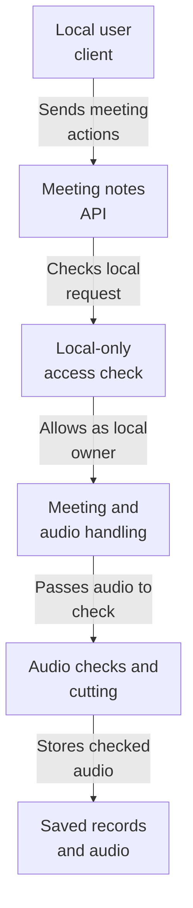
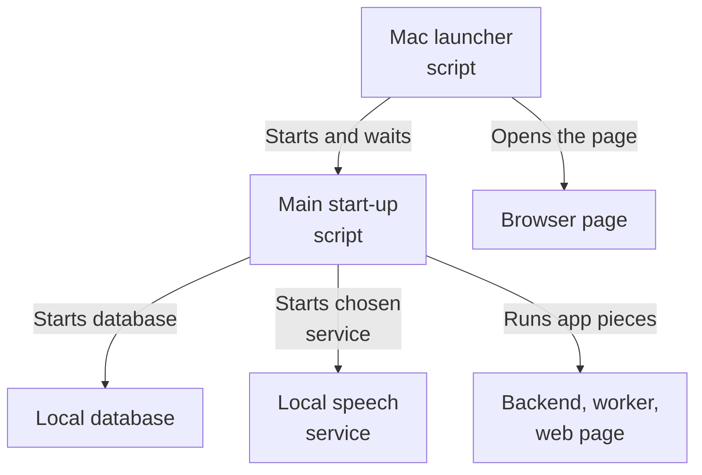
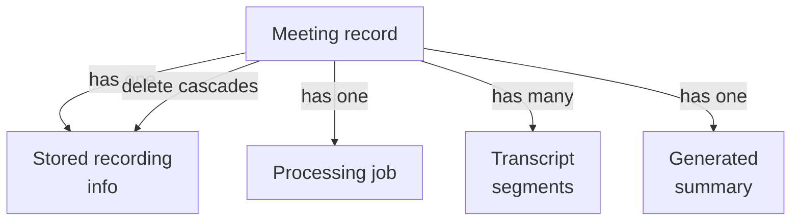
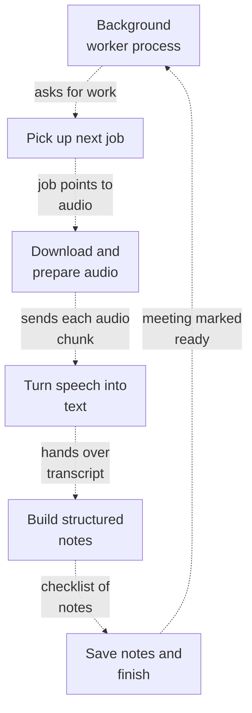
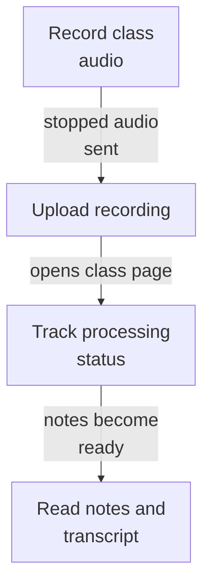

# Repository map

Source revision: `3f279169c3843b77bf5932f79bb601f7bff74120`

Browse the Mermaid diagrams below on GitHub. PDFs and PNGs are linked for download.

[Overview PDF](overview/repository-map.pdf) | [Overview details](overview/README.md)

## meeting-api: How a recording becomes study notes (1/2)

This area is the backend for a local class-recording notes tool. A person on the same machine creates a meeting, uploads audio (or streams live audio in pieces), and the system transcribes it and turns the transcript into structured study notes. Before any work starts, the system checks the file, limits how much can be uploaded, applies per-hour caps, and saves a job and audio record so processing can happen later. Only local requests from a fixed owner are allowed, and there is no real account login.

A local client asks the API to create a meeting and send audio; the system verifies the request is local, checks and stores the audio, queues a job, transcribes it, and builds structured study notes.

Read from top to bottom; arrows show what happens next or what is passed along.

[More about this area and its source evidence](maps/meeting-api/README.md)

## operations: How the app starts up

This area is the local launcher and build/run tooling for a class-recording notes app. Shell scripts on a Mac start the database in Docker, choose a local speech-to-text service, then bring up the backend API, a background worker, and the web page, opening it in the browser. Stop scripts and CI checks keep things repeatable; the whole stack stays on the local machine.

A person runs the Mac launcher, which starts the database, picks a local speech service, and brings up the app so the page opens in a browser.

Read from top to bottom; arrows show what happens next or what is passed along.

[More about this area and its source evidence](maps/operations/README.md)

## persistence: How a meeting's notes data is organized

This area stores and protects the data behind a meeting-notes service: meetings, their uploaded recordings, transcription jobs, transcript text, and generated summaries. It also sets up database structure, private file storage, error replies, and structured logs. Most pieces are foundations (schema, settings, storage); the actual web endpoints and background workers are not shown here.

A meeting is the central record. Its recording, processing job, transcript pieces, and summary all belong to it, and removing the meeting removes them all.

Read from top to bottom; arrows show what happens next or what is passed along.

[More about this area and its source evidence](maps/persistence/README.md)

## processing: How a recording becomes meeting notes

This area is the background processing engine for a meeting-notes app. A separate worker process quietly picks up queued jobs, converts uploaded audio into text, and turns that text into structured class notes with topics, decisions, and action items. It also periodically deletes expired audio and abandoned drafts. Some provider wiring and the surrounding web endpoints are only partly shown.

A background worker process loops continuously, claiming one queued job at a time, transcribing and then summarizing it, and saving the outcome.

Read from top to bottom. Dashed arrows show connections that need confirmation.

[More about this area and its source evidence](maps/processing/README.md)

## web: How a class recording becomes study notes

This area is the web workspace for a private class-recording notes tool. From the browser you record a class, watch it upload and be transcribed, then read AI-generated study notes tied back to the transcript. It also lets you browse, rename, regenerate notes for, delete, or recover your recordings.

You record audio in the browser; it is uploaded for processing; afterwards the page shows a transcript and AI-generated notes, refreshed automatically until ready.

Read from top to bottom; arrows show what happens next or what is passed along.

[More about this area and its source evidence](maps/web/README.md)

## Subsystem maps

| Map | Summary | Views | Last analyzed source |
| --- | --- | --- | --- |
| [meeting-api](maps/meeting-api/README.md) | This area is the backend for a local class-recording notes tool. A person on the same machine creates a meeting, uploads audio (or streams live audio in pieces), and the system transcribes it and turns the transcript into structured study notes. Before any work starts, the system checks the file, limits how much can be uploaded, applies per-hour caps, and saves a job and audio record so processing can happen later. Only local requests from a fixed owner are allowed, and there is no real account login. | [PDF](maps/meeting-api/repository-map.pdf) · [JSON](maps/meeting-api/map.json) | `3f279169c384` |
| [operations](maps/operations/README.md) | This area is the local launcher and build/run tooling for a class-recording notes app. Shell scripts on a Mac start the database in Docker, choose a local speech-to-text service, then bring up the backend API, a background worker, and the web page, opening it in the browser. Stop scripts and CI checks keep things repeatable; the whole stack stays on the local machine. | [PDF](maps/operations/repository-map.pdf) · [JSON](maps/operations/map.json) | `3f279169c384` |
| [persistence](maps/persistence/README.md) | This area stores and protects the data behind a meeting-notes service: meetings, their uploaded recordings, transcription jobs, transcript text, and generated summaries. It also sets up database structure, private file storage, error replies, and structured logs. Most pieces are foundations (schema, settings, storage); the actual web endpoints and background workers are not shown here. | [PDF](maps/persistence/repository-map.pdf) · [JSON](maps/persistence/map.json) | `3f279169c384` |
| [processing](maps/processing/README.md) | This area is the background processing engine for a meeting-notes app. A separate worker process quietly picks up queued jobs, converts uploaded audio into text, and turns that text into structured class notes with topics, decisions, and action items. It also periodically deletes expired audio and abandoned drafts. Some provider wiring and the surrounding web endpoints are only partly shown. | [PDF](maps/processing/repository-map.pdf) · [JSON](maps/processing/map.json) | `3f279169c384` |
| [web](maps/web/README.md) | This area is the web workspace for a private class-recording notes tool. From the browser you record a class, watch it upload and be transcribed, then read AI-generated study notes tied back to the transcript. It also lets you browse, rename, regenerate notes for, delete, or recover your recordings. | [PDF](maps/web/repository-map.pdf) · [JSON](maps/web/map.json) | `3f279169c384` |

JSON is the source of truth; Mermaid, PNGs, and PDFs are generated views.

Unchanged subsystem views are retained. Source existence checks do not prove model interpretation. See manifest.json and update.json for dependencies, coverage and updates.
