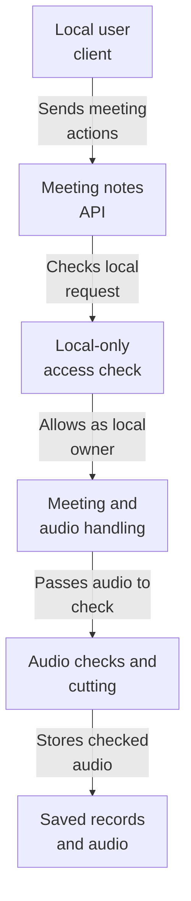
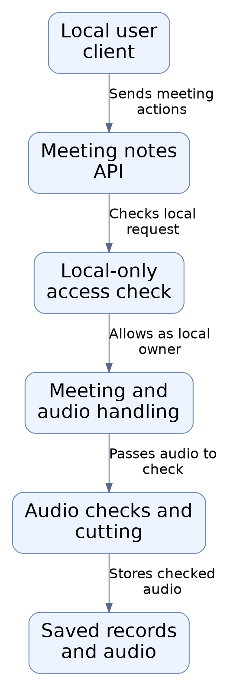
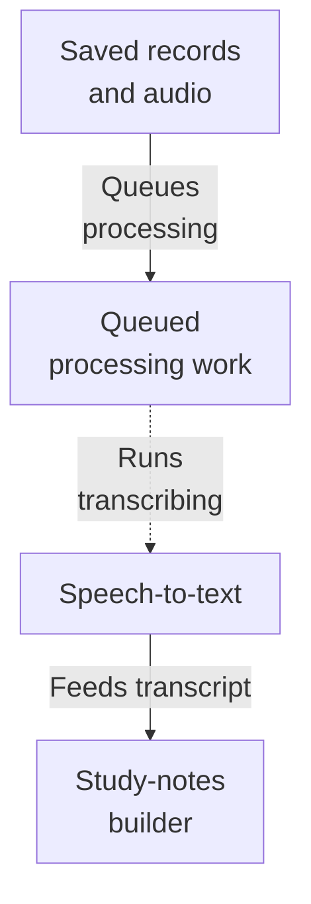
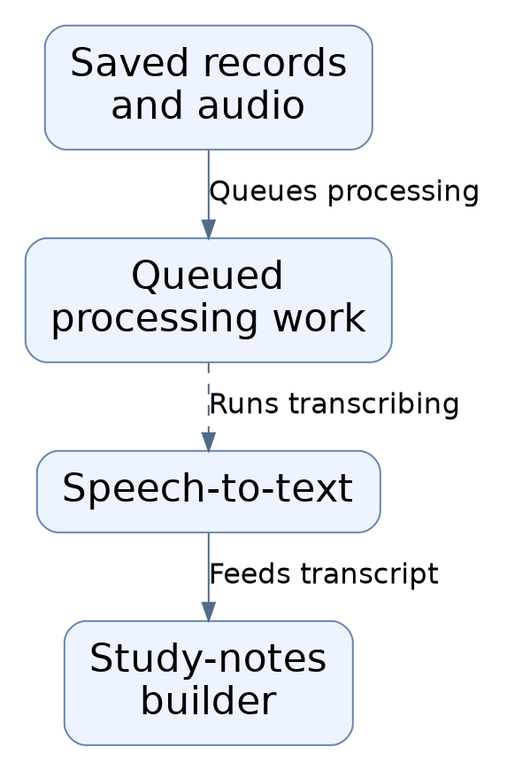
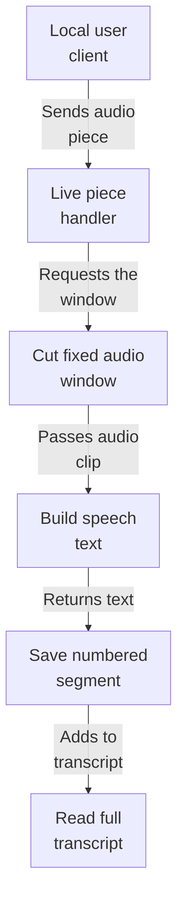
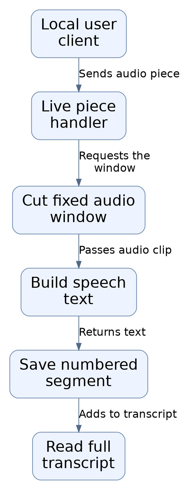
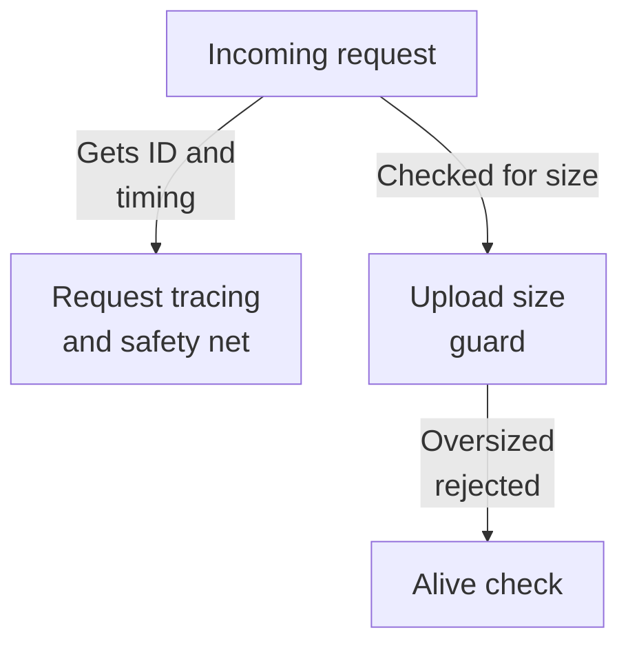
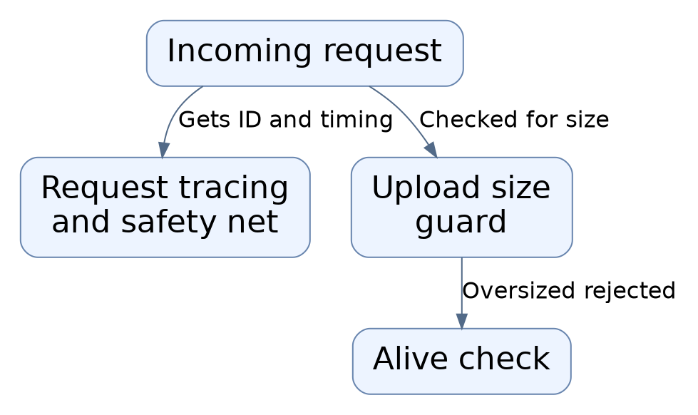
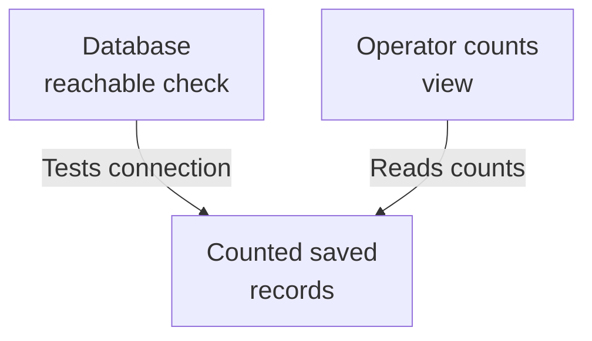
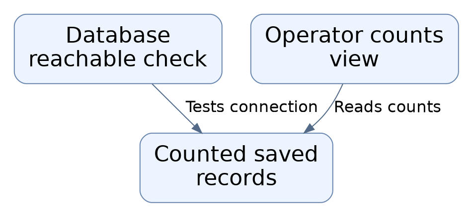

# Repository map

This area is the backend for a local class-recording notes tool. A person on the same machine creates a meeting, uploads audio (or streams live audio in pieces), and the system transcribes it and turns the transcript into structured study notes. Before any work starts, the system checks the file, limits how much can be uploaded, applies per-hour caps, and saves a job and audio record so processing can happen later. Only local requests from a fixed owner are allowed, and there is no real account login.

Commit: `3f279169c3843b77bf5932f79bb601f7bff74120` | Generated: 2026-10-19T00:29:57.211238+00:00

[Open PDF](repository-map.pdf)

**AI-generated analysis. Source references are checked for existence and supplied scope; this does not prove semantic correctness.**

## Scope

Tracked, eligible text only; bounded excerpts, not exhaustive.

15/15 eligible files analyzed; 87 tracked files excluded by policy.

6 API calls. See coverage.json for budgets, exclusions, and usage.

## How a recording becomes study notes (1/2)

A local client asks the API to create a meeting and send audio; the system verifies the request is local, checks and stores the audio, queues a job, transcribes it, and builds structured study notes.

PNG fallback

Read from top to bottom; arrows show what happens next or what is passed along.

### Source evidence

- **F0018**: Authentication in this build is environment-based rather than account-based: get_current_user only allows requests whose client IP is loopback, whose request hostname is localhost/127.0.0.1/::1, and whose Origin header matches an allowed local web origin when present, always returning the fixed LOCAL_OWNER_ID. Mutating methods require an Origin header. (<a href="https://github.com/Justin-Mendoza/AI-Notetaker/blob/3f279169c3843b77bf5932f79bb601f7bff74120/apps/api/app/auth/local.py#L1-L54">apps/api/app/auth/local.py:1-54</a>)
- **F0011**: CORSMiddleware is configured with allow_origins from local_web_origins(), methods GET/POST/PATCH/DELETE, and headers Authorization, Content-Type, Idempotency-Key, defining which browser clients may call the API and which headers/capabilities (including idempotency key usage) are exposed. (<a href="https://github.com/Justin-Mendoza/AI-Notetaker/blob/3f279169c3843b77bf5932f79bb601f7bff74120/apps/api/app/main.py#L1-L110">apps/api/app/main.py:1-110</a>)
- **F0001**: The FastAPI application object (app) is the composition root of the meeting-notes HTTP API; it wires middleware, exception handlers, infrastructure endpoints, and the meetings router, defining the HTTP surface users and operators interact with. (<a href="https://github.com/Justin-Mendoza/AI-Notetaker/blob/3f279169c3843b77bf5932f79bb601f7bff74120/apps/api/app/main.py#L1-L110">apps/api/app/main.py:1-110</a>)
- **F0013**: The module docstring identifies the package as the 'Meeting Notes API', and the app is titled 'Class Notes API' version 0.1.0, indicating the purpose is a meeting/class-recording notes backend. (<a href="https://github.com/Justin-Mendoza/AI-Notetaker/blob/3f279169c3843b77bf5932f79bb601f7bff74120/apps/api/app/main.py#L1-L110">apps/api/app/main.py:1-110</a>, <a href="https://github.com/Justin-Mendoza/AI-Notetaker/blob/3f279169c3843b77bf5932f79bb601f7bff74120/apps/api/app/__init__.py#L1-L1">apps/api/app/__init__.py:1-1</a>)
- **F0019**: create_meeting enforces a rolling one-hour per-owner creation cap (settings.max_meetings_per_hour) returning 429, then stores a draft Meeting with title (default 'Untitled class'), consent timestamp and consent policy version, and returns the created meeting. (<a href="https://github.com/Justin-Mendoza/AI-Notetaker/blob/3f279169c3843b77bf5932f79bb601f7bff74120/apps/api/app/api/meetings.py#L1-L504">apps/api/app/api/meetings.py:1-504</a>)
- **F0020**: list_meetings pages a user's non-deleted meetings newest-first with keyset pagination: limit is bounded 1-100, the cursor encodes (created_at, id) as base64url JSON, and an optional next_cursor is returned only when more rows exist. (<a href="https://github.com/Justin-Mendoza/AI-Notetaker/blob/3f279169c3843b77bf5932f79bb601f7bff74120/apps/api/app/api/meetings.py#L1-L504">apps/api/app/api/meetings.py:1-504</a>)
- **F0022**: rename_meeting updates only the title (validated to 1-160 trimmed characters) and updated_at for an owned meeting. (<a href="https://github.com/Justin-Mendoza/AI-Notetaker/blob/3f279169c3843b77bf5932f79bb601f7bff74120/apps/api/app/api/meetings.py#L1-L504">apps/api/app/api/meetings.py:1-504</a>)
- **F0023**: transcribe_live_window accepts an uploaded audio prefix plus a sequence_no and Idempotency-Key, requires the meeting to still be in 'draft' state, and treats the first key as binding the meeting's upload_key; mismatched keys or a non-draft meeting produce 409 INVALID_STATE. (<a href="https://github.com/Justin-Mendoza/AI-Notetaker/blob/3f279169c3843b77bf5932f79bb601f7bff74120/apps/api/app/api/meetings.py#L1-L504">apps/api/app/api/meetings.py:1-504</a>)
- **F0027**: get_live_transcript returns all transcript segments for an owned meeting ordered by sequence_no along with a newline-joined full_text. (<a href="https://github.com/Justin-Mendoza/AI-Notetaker/blob/3f279169c3843b77bf5932f79bb601f7bff74120/apps/api/app/api/meetings.py#L1-L504">apps/api/app/api/meetings.py:1-504</a>)
- **F0028**: upload_recording accepts a recording file plus duration_ms and Idempotency-Key; it rejects duplicate recordings for a meeting (409 RECORDING_EXISTS) unless the same idempotency key is replayed (idempotent success), enforces a rolling one-hour upload cap (429), and requires meeting status draft/uploading with a matching upload_key. (<a href="https://github.com/Justin-Mendoza/AI-Notetaker/blob/3f279169c3843b77bf5932f79bb601f7bff74120/apps/api/app/api/meetings.py#L1-L504">apps/api/app/api/meetings.py:1-504</a>)
- **F0041**: inspect_audio validates an upload by checking the claimed MIME type maps to a known container and that the file's magic bytes match that container, rejecting mismatches with 415 UNSUPPORTED_MEDIA; this guards against spoofed content types. (<a href="https://github.com/Justin-Mendoza/AI-Notetaker/blob/3f279169c3843b77bf5932f79bb601f7bff74120/apps/api/app/services/media.py#L1-L117">apps/api/app/services/media.py:1-117</a>)
- **F0042**: inspect_audio runs ffprobe (30s timeout) to require at least one audio stream and reject any video stream, erroring with 415 INVALID_MEDIA on probe failure, missing audio, video presence, or unreadable duration. (<a href="https://github.com/Justin-Mendoza/AI-Notetaker/blob/3f279169c3843b77bf5932f79bb601f7bff74120/apps/api/app/services/media.py#L1-L117">apps/api/app/services/media.py:1-117</a>)
- **F0044**: inspect_audio enforces a 120-minute maximum: durations exceeding MAX_DURATION_MS plus ENCODER_PADDING_MS (250ms allowance for encoder delay/padding) raise 413 DURATION_LIMIT, and accepted durations are capped at MAX_DURATION_MS. (<a href="https://github.com/Justin-Mendoza/AI-Notetaker/blob/3f279169c3843b77bf5932f79bb601f7bff74120/apps/api/app/services/media.py#L1-L117">apps/api/app/services/media.py:1-117</a>)
- **F0069**: split_audio normalizes source audio via ffmpeg to mono 16 kHz 32kbps MP3, then slices it into approximate 10-minute chunks, dropping a trailing sub-1-second segment and emitting AudioChunk records with sequence numbers and start/end millisecond offsets. (<a href="https://github.com/Justin-Mendoza/AI-Notetaker/blob/3f279169c3843b77bf5932f79bb601f7bff74120/apps/api/app/worker/audio.py#L1-L88">apps/api/app/worker/audio.py:1-88</a>)
- **F0015**: Data-related behavior is split: persistent state lives in a SQLAlchemy database accessed through engine/SessionLocal, with models ProcessingJob, Recording, and a utc_now() helper used for time comparisons; recordings have a purge_after field and a soft-delete deleted_at field, suggesting an audio retention/purge lifecycle. (<a href="https://github.com/Justin-Mendoza/AI-Notetaker/blob/3f279169c3843b77bf5932f79bb601f7bff74120/apps/api/app/main.py#L1-L110">apps/api/app/main.py:1-110</a>)
- **F0029**: Upload handling writes the file to a temporary path while computing a SHA-256 digest and enforcing MAX_FILE_BYTES and non-empty checks, validates real MIME type and duration via inspect_audio, derives a file extension from the detected MIME type, and stores the object via the storage dependency under a key of owner_id/meeting_id/random uuid plus extension. (<a href="https://github.com/Justin-Mendoza/AI-Notetaker/blob/3f279169c3843b77bf5932f79bb601f7bff74120/apps/api/app/api/meetings.py#L1-L504">apps/api/app/api/meetings.py:1-504</a>)
- **F0030**: On successful upload the code locks the meeting row, re-checks ownership/deletion/status, records a Recording with object_key, mime_type, size, sha256, upload idempotency key, upload timestamp and purge_after (based on settings.failed_audio_retention_days), creates a pending ProcessingJob with max_attempts 3, transitions the meeting to 'queued', and computes duration_ms as the max of measured duration and the latest live segment end_ms, deriving started_at/ended_at. (<a href="https://github.com/Justin-Mendoza/AI-Notetaker/blob/3f279169c3843b77bf5932f79bb601f7bff74120/apps/api/app/api/meetings.py#L1-L504">apps/api/app/api/meetings.py:1-504</a>)
- **F0017**: All meeting endpoints are mounted under the /v1/meetings prefix and require an owner identity from get_current_user plus a database session, so every operation is scoped to one local user; ownership is enforced by owned_meeting, which filters by owner_id and excludes soft-deleted rows and raises 404 MEETING_NOT_FOUND otherwise. (<a href="https://github.com/Justin-Mendoza/AI-Notetaker/blob/3f279169c3843b77bf5932f79bb601f7bff74120/apps/api/app/api/meetings.py#L1-L504">apps/api/app/api/meetings.py:1-504</a>)
- **F0025**: Live transcription streams the upload to a temporary directory, enforces the MAX_FILE_BYTES size limit (413) and rejects empty files (415), then calls extract_live_window and CohereLocalTranscriber (with a 90s timeout) outside any database transaction; only when settings.stt_provider == 'cohere_local', otherwise 503 LOCAL_STT_UNAVAILABLE. (<a href="https://github.com/Justin-Mendoza/AI-Notetaker/blob/3f279169c3843b77bf5932f79bb601f7bff74120/apps/api/app/api/meetings.py#L1-L504">apps/api/app/api/meetings.py:1-504</a>)

## How a recording becomes study notes (2/2)

A local client asks the API to create a meeting and send audio; the system verifies the request is local, checks and stores the audio, queues a job, transcribes it, and builds structured study notes.

PNG fallback

Read from top to bottom. Dashed arrows show connections that need confirmation.

### Source evidence

- **F0015**: Data-related behavior is split: persistent state lives in a SQLAlchemy database accessed through engine/SessionLocal, with models ProcessingJob, Recording, and a utc_now() helper used for time comparisons; recordings have a purge_after field and a soft-delete deleted_at field, suggesting an audio retention/purge lifecycle. (<a href="https://github.com/Justin-Mendoza/AI-Notetaker/blob/3f279169c3843b77bf5932f79bb601f7bff74120/apps/api/app/main.py#L1-L110">apps/api/app/main.py:1-110</a>)
- **F0029**: Upload handling writes the file to a temporary path while computing a SHA-256 digest and enforcing MAX_FILE_BYTES and non-empty checks, validates real MIME type and duration via inspect_audio, derives a file extension from the detected MIME type, and stores the object via the storage dependency under a key of owner_id/meeting_id/random uuid plus extension. (<a href="https://github.com/Justin-Mendoza/AI-Notetaker/blob/3f279169c3843b77bf5932f79bb601f7bff74120/apps/api/app/api/meetings.py#L1-L504">apps/api/app/api/meetings.py:1-504</a>)
- **F0030**: On successful upload the code locks the meeting row, re-checks ownership/deletion/status, records a Recording with object_key, mime_type, size, sha256, upload idempotency key, upload timestamp and purge_after (based on settings.failed_audio_retention_days), creates a pending ProcessingJob with max_attempts 3, transitions the meeting to 'queued', and computes duration_ms as the max of measured duration and the latest live segment end_ms, deriving started_at/ended_at. (<a href="https://github.com/Justin-Mendoza/AI-Notetaker/blob/3f279169c3843b77bf5932f79bb601f7bff74120/apps/api/app/api/meetings.py#L1-L504">apps/api/app/api/meetings.py:1-504</a>)
- **F0031** (inferred): The processing job kind is chosen at upload time: 'process_live_recording' when live_transcription is requested or any transcript segment already exists for the meeting, otherwise 'process_recording'. This selects background work whose actual execution is not shown in these excerpts. (<a href="https://github.com/Justin-Mendoza/AI-Notetaker/blob/3f279169c3843b77bf5932f79bb601f7bff74120/apps/api/app/api/meetings.py#L1-L504">apps/api/app/api/meetings.py:1-504</a>)
- **F0049**: Transcription converts an audio file on disk into plain text via a provider client; OpenAITranscriber opens the file and calls the OpenAI audio transcriptions API, returning the stripped text, so the input is a Path and the output is a string (S0012). (<a href="https://github.com/Justin-Mendoza/AI-Notetaker/blob/3f279169c3843b77bf5932f79bb601f7bff74120/apps/api/app/services/transcription.py#L1-L126">apps/api/app/services/transcription.py:1-126</a>)
- **F0050**: create_transcriber selects a transcription implementation from settings.stt_provider among cohere_local, openai, and whisper_local, raising a non-transient TranscriptionError when the configured provider name is unknown (S0012). (<a href="https://github.com/Justin-Mendoza/AI-Notetaker/blob/3f279169c3843b77bf5932f79bb601f7bff74120/apps/api/app/services/transcription.py#L1-L126">apps/api/app/services/transcription.py:1-126</a>)
- **F0025**: Live transcription streams the upload to a temporary directory, enforces the MAX_FILE_BYTES size limit (413) and rejects empty files (415), then calls extract_live_window and CohereLocalTranscriber (with a 90s timeout) outside any database transaction; only when settings.stt_provider == 'cohere_local', otherwise 503 LOCAL_STT_UNAVAILABLE. (<a href="https://github.com/Justin-Mendoza/AI-Notetaker/blob/3f279169c3843b77bf5932f79bb601f7bff74120/apps/api/app/api/meetings.py#L1-L504">apps/api/app/api/meetings.py:1-504</a>)
- **F0053**: Summarization turns a list of timestamped transcript segments into structured study notes (overview, key points, topics with evidence IDs, decisions, action items, open questions) validated against a strict JSON schema and Pydantic models (S0011). (<a href="https://github.com/Justin-Mendoza/AI-Notetaker/blob/3f279169c3843b77bf5932f79bb601f7bff74120/apps/api/app/services/summarization.py#L1-L367">apps/api/app/services/summarization.py:1-367</a>)
- **F0060**: create_summarizer selects between openai and kyma providers from settings.summary_provider and raises SUMMARY_PROVIDER_INVALID (non-transient) for anything else (S0011). (<a href="https://github.com/Justin-Mendoza/AI-Notetaker/blob/3f279169c3843b77bf5932f79bb601f7bff74120/apps/api/app/services/summarization.py#L1-L367">apps/api/app/services/summarization.py:1-367</a>)

## Live audio arriving in pieces

A local client sends numbered audio pieces during an ongoing recording; the system cuts a fixed window, transcribes it, stores the text under that number, and can return the full transcript so far.

PNG fallback

Read from top to bottom; arrows show what happens next or what is passed along.

### Source evidence

- **F0018**: Authentication in this build is environment-based rather than account-based: get_current_user only allows requests whose client IP is loopback, whose request hostname is localhost/127.0.0.1/::1, and whose Origin header matches an allowed local web origin when present, always returning the fixed LOCAL_OWNER_ID. Mutating methods require an Origin header. (<a href="https://github.com/Justin-Mendoza/AI-Notetaker/blob/3f279169c3843b77bf5932f79bb601f7bff74120/apps/api/app/auth/local.py#L1-L54">apps/api/app/auth/local.py:1-54</a>)
- **F0023**: transcribe_live_window accepts an uploaded audio prefix plus a sequence_no and Idempotency-Key, requires the meeting to still be in 'draft' state, and treats the first key as binding the meeting's upload_key; mismatched keys or a non-draft meeting produce 409 INVALID_STATE. (<a href="https://github.com/Justin-Mendoza/AI-Notetaker/blob/3f279169c3843b77bf5932f79bb601f7bff74120/apps/api/app/api/meetings.py#L1-L504">apps/api/app/api/meetings.py:1-504</a>)
- **F0025**: Live transcription streams the upload to a temporary directory, enforces the MAX_FILE_BYTES size limit (413) and rejects empty files (415), then calls extract_live_window and CohereLocalTranscriber (with a 90s timeout) outside any database transaction; only when settings.stt_provider == 'cohere_local', otherwise 503 LOCAL_STT_UNAVAILABLE. (<a href="https://github.com/Justin-Mendoza/AI-Notetaker/blob/3f279169c3843b77bf5932f79bb601f7bff74120/apps/api/app/api/meetings.py#L1-L504">apps/api/app/api/meetings.py:1-504</a>)
- **F0038**: extract_live_window produces one fixed 60-second MP3 window from a growing source recording, derived by sequence number, for live/incremental processing. (<a href="https://github.com/Justin-Mendoza/AI-Notetaker/blob/3f279169c3843b77bf5932f79bb601f7bff74120/apps/api/app/services/live.py#L1-L45">apps/api/app/services/live.py:1-45</a>)
- **F0039**: Live window extraction first inspects the source duration and raises ApiError 409 LIVE_AUDIO_PENDING if the requested window end is not yet captured, indicating polling-based consumption of an in-progress recording. (<a href="https://github.com/Justin-Mendoza/AI-Notetaker/blob/3f279169c3843b77bf5932f79bb601f7bff74120/apps/api/app/services/live.py#L1-L45">apps/api/app/services/live.py:1-45</a>)
- **F0040**: The live window is produced by invoking ffmpeg with a 120s timeout to trim from the sequence offset, downmix to mono 16kHz 32kbps MP3; if ffmpeg fails the error is translated to ApiError 415 INVALID_MEDIA, and the output is re-inspected to confirm a full window (LIVE_AUDIO_PENDING otherwise). (<a href="https://github.com/Justin-Mendoza/AI-Notetaker/blob/3f279169c3843b77bf5932f79bb601f7bff74120/apps/api/app/services/live.py#L1-L45">apps/api/app/services/live.py:1-45</a>)
- **F0051**: WhisperLocalTranscriber and CohereLocalTranscriber enforce that the configured base URL is loopback-only HTTP under /v1 with no credentials, query, or fragment, rejecting other URLs with LOC AL_STT_URL_INVALID before creating the client (S0012). (<a href="https://github.com/Justin-Mendoza/AI-Notetaker/blob/3f279169c3843b77bf5932f79bb601f7bff74120/apps/api/app/services/transcription.py#L1-L126">apps/api/app/services/transcription.py:1-126</a>)
- **F0026**: After inference, live transcription re-fetches the meeting with a row lock, re-verifies draft status and matching idempotency key, and inserts a TranscriptSegment tagged with sequence_no and start/end offsets derived from sequence_no and LIVE_CHUNK_MS, storing provider and model names. Transcription failures raise 503 with the transcriber's error code and a message that saved audio can catch up later. (<a href="https://github.com/Justin-Mendoza/AI-Notetaker/blob/3f279169c3843b77bf5932f79bb601f7bff74120/apps/api/app/api/meetings.py#L1-L504">apps/api/app/api/meetings.py:1-504</a>)
- **F0027**: get_live_transcript returns all transcript segments for an owned meeting ordered by sequence_no along with a newline-joined full_text. (<a href="https://github.com/Justin-Mendoza/AI-Notetaker/blob/3f279169c3843b77bf5932f79bb601f7bff74120/apps/api/app/api/meetings.py#L1-L504">apps/api/app/api/meetings.py:1-504</a>)

## Keeping the service healthy and watched (1/2)

Each incoming request gets a tracking ID, timing, and a log line; oversized uploads are cut off early; small endpoints report liveness, database reachability, and counts of queued or overdue records for operators.

PNG fallback

Read from top to bottom; arrows show what happens next or what is passed along.

### Source evidence

- **F0003**: An HTTP middleware assigns every request a UUID in request.state.request_id, times it with time.monotonic, attaches an X-Request-ID response header, and emits an 'http_request' log with request_id, status_code, and duration_ms; this is the per-request observability path and start of user-facing request flow. (<a href="https://github.com/Justin-Mendoza/AI-Notetaker/blob/3f279169c3843b77bf5932f79bb601f7bff74120/apps/api/app/main.py#L1-L110">apps/api/app/main.py:1-110</a>)
- **F0004**: The same middleware catches UploadTooLarge and converts it to a 413 REQUEST_TOO_LARGE error response, and catches any other exception to return a generic 500 INTERNAL_ERROR response, so unhandled failures are normalized rather than propagating. (<a href="https://github.com/Justin-Mendoza/AI-Notetaker/blob/3f279169c3843b77bf5932f79bb601f7bff74120/apps/api/app/main.py#L1-L110">apps/api/app/main.py:1-110</a>)
- **F0005**: UploadLimitMiddleware is added to the app, enforcing an upload size limit for incoming requests, with UploadTooLarge as its signal consumed by the request middleware. (<a href="https://github.com/Justin-Mendoza/AI-Notetaker/blob/3f279169c3843b77bf5932f79bb601f7bff74120/apps/api/app/main.py#L1-L110">apps/api/app/main.py:1-110</a>)
- **F0067**: UploadLimitMiddleware bounds HTTP requests whose path ends in /recording or /live-transcript: it rejects content-length above MAX_UPLOAD_REQUEST_BYTES and wraps receive() to count streamed body bytes, raising UploadTooLarge past the same limit, before FastAPI spools multipart data to disk. (<a href="https://github.com/Justin-Mendoza/AI-Notetaker/blob/3f279169c3843b77bf5932f79bb601f7bff74120/apps/api/app/size_limit.py#L1-L40">apps/api/app/size_limit.py:1-40</a>)
- **F0006**: The GET /healthz endpoint returns {'status':'ok'} with no dependency checks, serving as a liveness probe. (<a href="https://github.com/Justin-Mendoza/AI-Notetaker/blob/3f279169c3843b77bf5932f79bb601f7bff74120/apps/api/app/main.py#L1-L110">apps/api/app/main.py:1-110</a>)

## Keeping the service healthy and watched (2/2)

Each incoming request gets a tracking ID, timing, and a log line; oversized uploads are cut off early; small endpoints report liveness, database reachability, and counts of queued or overdue records for operators.

PNG fallback

Read from top to bottom; arrows show what happens next or what is passed along.

### Source evidence

- **F0007**: The GET /readyz endpoint opens a SQLAlchemy engine connection and executes 'SELECT 1'; on any exception it raises ApiError(503,'DATABASE_UNAVAILABLE'), making it a readiness probe that verifies actual database connectivity. (<a href="https://github.com/Justin-Mendoza/AI-Notetaker/blob/3f279169c3843b77bf5932f79bb601f7bff74120/apps/api/app/main.py#L1-L110">apps/api/app/main.py:1-110</a>)
- **F0008**: The GET /internal/metrics endpoint is excluded from the OpenAPI schema and is gated: if settings.metrics_token is unset it returns 404, otherwise it requires an Authorization header equal to 'Bearer &lt;token&gt;' compared with hmac.compare_digest, returning 401 otherwise. This is an operator-only observability surface. (<a href="https://github.com/Justin-Mendoza/AI-Notetaker/blob/3f279169c3843b77bf5932f79bb601f7bff74120/apps/api/app/main.py#L1-L110">apps/api/app/main.py:1-110</a>)
- **F0009**: The metrics endpoint queries the database via SessionLocal to count ProcessingJob rows grouped by status and to count Recording rows whose purge_after is before utc_now() and deleted_at is null, then emits Prometheus-style text gauges meeting_jobs{status=...} for pending/running/failed/completed and meeting_overdue_audio. (<a href="https://github.com/Justin-Mendoza/AI-Notetaker/blob/3f279169c3843b77bf5932f79bb601f7bff74120/apps/api/app/main.py#L1-L110">apps/api/app/main.py:1-110</a>)

## Layout notes

- Split "How a recording becomes study notes" into 2 readable views. Repeated node IDs connect the views; all nodes, arrows, and evidence are retained.
- Split "Keeping the service healthy and watched" into 2 readable views. Repeated node IDs connect the views; all nodes, arrows, and evidence are retained.

## Uncertainties and untraced areas

- The API's meeting handlers are mounted, but what each meeting endpoint returns in full detail is not shown here.
- Background processing jobs are created with a kind chosen at upload time, but nothing here shows the code that actually runs them.
- The speech-to-text and summarization providers are selected from settings, but the code paths that invoke them during background processing are not shown.
- Whether the upload size guard is actually attached to the running application is inferred, not observed.
- The audio-splitting worker exists, but how it is scheduled or connected to uploads is inferred from naming and context.
- Live audio extraction depends on external ffmpeg/ffprobe tools being installed, but their availability is not confirmed here.
- How a user obtains or uses an idempotency key across repeated calls is described only through endpoint behavior, not shown end to end.
