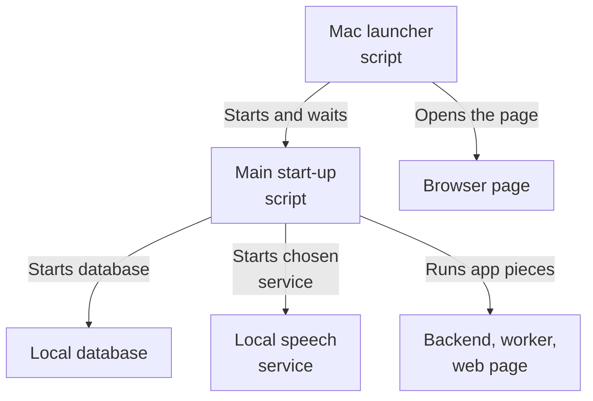
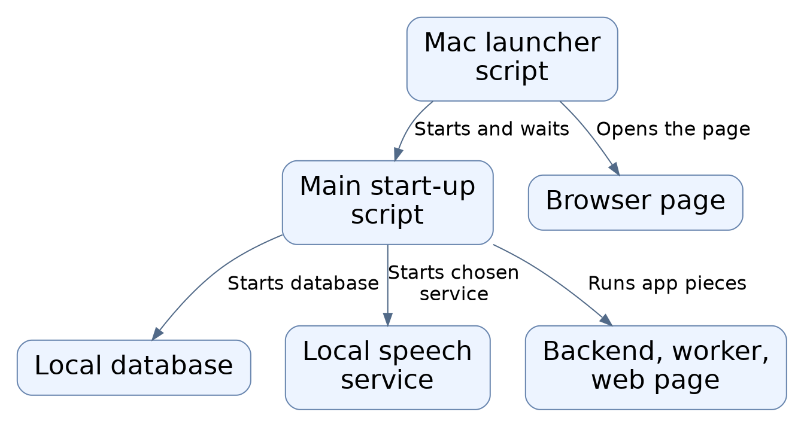
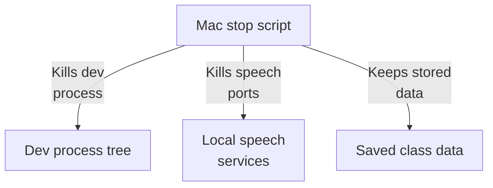
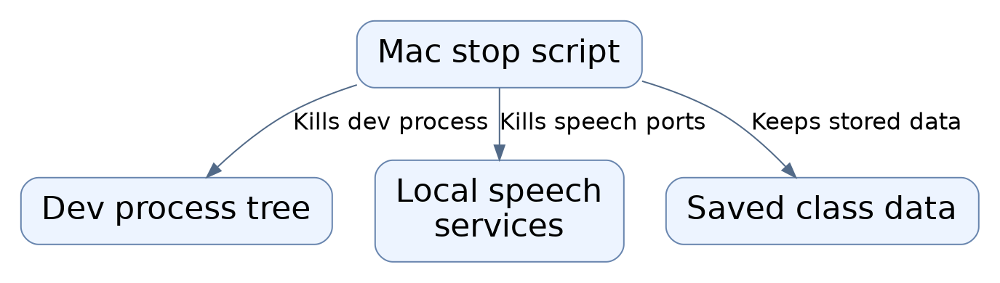
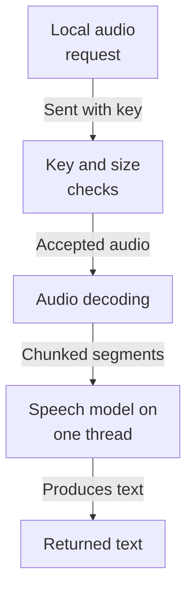
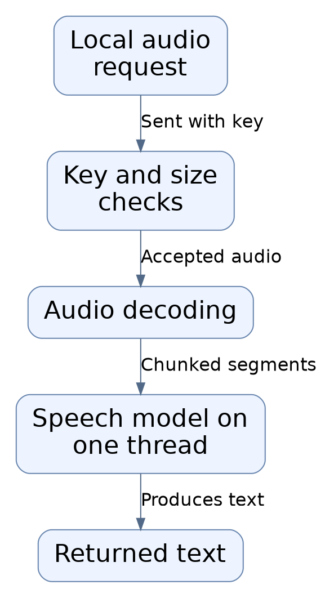
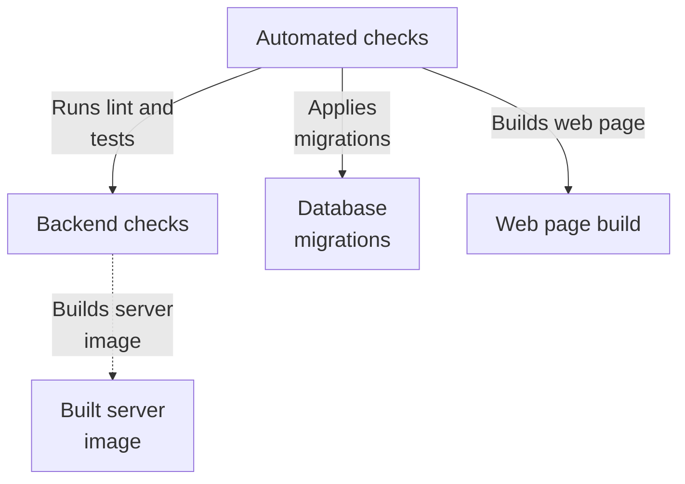
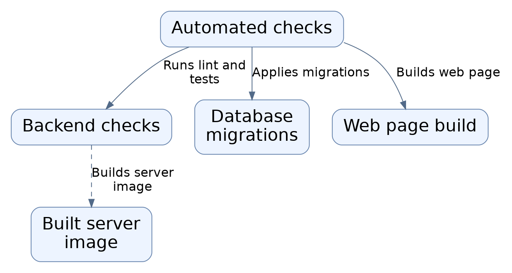

# Repository map

This area is the local launcher and build/run tooling for a class-recording notes app. Shell scripts on a Mac start the database in Docker, choose a local speech-to-text service, then bring up the backend API, a background worker, and the web page, opening it in the browser. Stop scripts and CI checks keep things repeatable; the whole stack stays on the local machine.

Commit: `3f279169c3843b77bf5932f79bb601f7bff74120` | Generated: 2026-10-19T00:30:29.664809+00:00

[Open PDF](repository-map.pdf)

**AI-generated analysis. Source references are checked for existence and supplied scope; this does not prove semantic correctness.**

## Scope

Tracked, eligible text only; bounded excerpts, not exhaustive.

12/12 eligible files analyzed; 90 tracked files excluded by policy.

2 API calls. See coverage.json for budgets, exclusions, and usage.

## How the app starts up

A person runs the Mac launcher, which starts the database, picks a local speech service, and brings up the app so the page opens in a browser.

PNG fallback

Read from top to bottom; arrows show what happens next or what is passed along.

### Source evidence

- **F0013**: scripts/start-mac.sh is a user-facing launcher: it verifies/starts Docker Desktop, detects an already-running app (probes localhost:3000 and /readyz on :8000), reuses a recorded running dev.sh PID or starts scripts/dev.sh as a child, waits up to 120s for both services, then opens http://localhost:3000 in the browser; it traps EXIT/INT/TERM to kill the dev process it started. (<a href="https://github.com/Justin-Mendoza/AI-Notetaker/blob/3f279169c3843b77bf5932f79bb601f7bff74120/scripts/start-mac.sh#L1-L71">scripts/start-mac.sh:1-71</a>)
- **F0008**: scripts/dev.sh (the 'Class Notes' launcher) requires .env with a KYMA_API_KEY (placeholder rejected), creates a permission-restricted .data directory, uses a PID file with process-identity check to avoid double starts, brings up docker compose with a 120s wait, applies Alembic migrations, conditionally starts Whisper Local (port 7777) or Cohere Local (port 7778) based on STT_PROVIDER, then runs the API (uvicorn 127.0.0.1:8000), the background worker (python -m app.worker.main), and the Next.js web dev server (127.0.0.1:3000). (<a href="https://github.com/Justin-Mendoza/AI-Notetaker/blob/3f279169c3843b77bf5932f79bb601f7bff74120/scripts/dev.sh#L1-L100">scripts/dev.sh:1-100</a>)
- **F0004**: docker-compose.yml provides only a Postgres 17 service on host port 127.0.0.1:5432 with a persistent named volume postgres_data; the API, worker, and web run outside compose (started by dev.sh) while Docker backs the database. (<a href="https://github.com/Justin-Mendoza/AI-Notetaker/blob/3f279169c3843b77bf5932f79bb601f7bff74120/docker-compose.yml#L1-L18">docker-compose.yml:1-18</a>, <a href="https://github.com/Justin-Mendoza/AI-Notetaker/blob/3f279169c3843b77bf5932f79bb601f7bff74120/scripts/dev.sh#L1-L100">scripts/dev.sh:1-100</a>)
- **F0014**: scripts/start-whisper-local.sh requires a pre-installed .venv-whisper-local/bin/whisper-local and execs it in --serve mode on 127.0.0.1:7777. (<a href="https://github.com/Justin-Mendoza/AI-Notetaker/blob/3f279169c3843b77bf5932f79bb601f7bff74120/scripts/start-whisper-local.sh#L1-L12">scripts/start-whisper-local.sh:1-12</a>)
- **F0012**: scripts/start-cohere-local.sh requires a separate .venv-cohere-speech virtualenv, sets HF_HOME to .data/cohere-cache, resolves the model name from app.settings.cohere_local_model by default, forces HF_HUB_OFFLINE=1, and serves cohere_server:app on 127.0.0.1:7778. (<a href="https://github.com/Justin-Mendoza/AI-Notetaker/blob/3f279169c3843b77bf5932f79bb601f7bff74120/scripts/start-cohere-local.sh#L1-L12">scripts/start-cohere-local.sh:1-12</a>)

## How the app is shut down

A stop script checks recorded process identities, kills the start-up process tree and local speech services, then takes the database down while keeping saved classes.

PNG fallback

Read from top to bottom; arrows show what happens next or what is passed along.

### Source evidence

- **F0015**: scripts/stop-mac.sh verifies the recorded PID's command line still references scripts/dev.sh (refusing to kill a mismatched process), term-recursively kills the dev process tree, waits, then separately TERM-kills Whisper Local on TCP 7777 and Cohere Local on TCP 7778 only when their command lines match expected binaries, and finally runs docker compose down; saved classes remain in the Docker volume. (<a href="https://github.com/Justin-Mendoza/AI-Notetaker/blob/3f279169c3843b77bf5932f79bb601f7bff74120/scripts/stop-mac.sh#L1-L68">scripts/stop-mac.sh:1-68</a>)

## How a transcription request is served locally

A local transcription request is checked for the fixed key, model match, and size, then audio is decoded and run through the speech model on one dedicated thread.

PNG fallback

Read from top to bottom; arrows show what happens next or what is passed along.

### Source evidence

- **F0005**: scripts/cohere_server.py is a loopback-only FastAPI service exposing /health and POST /v1/audio/transcriptions. It requires a fixed bearer 'local-cohere' and an exact model-name match, enforces a 20 MB upload limit, decodes audio via ffmpeg to 16 kHz mono WAV, and returns {"text": ...}; model/VAD are loaded at startup in a single background worker thread. (<a href="https://github.com/Justin-Mendoza/AI-Notetaker/blob/3f279169c3843b77bf5932f79bb601f7bff74120/scripts/cohere_server.py#L1-L152">scripts/cohere_server.py:1-152</a>)
- **F0006**: Cohere transcription isolates MLX/GPU work on one dedicated thread (ThreadPoolExecutor max_workers=1, thread_name_prefix 'cohere-gpu'), serializes calls with a threading.Lock, and segments audio into runs with max_chunk_s=35 before ASR; failures map to specific HTTP codes (401, 400, 413, 422, 503) and error messages deliberately avoid leaking audio or model exception payloads. (<a href="https://github.com/Justin-Mendoza/AI-Notetaker/blob/3f279169c3843b77bf5932f79bb601f7bff74120/scripts/cohere_server.py#L1-L152">scripts/cohere_server.py:1-152</a>)

## What the automated checks do

Continuous integration checks the backend against a test database, applies and verifies database migrations, builds the server image, and separately installs, checks, and builds the web page.

PNG fallback

Read from top to bottom. Dashed arrows show connections that need confirmation.

### Source evidence

- **F0003**: CI runs two jobs: an API job that provisions a Postgres 16 service, lints with ruff, runs pytest, applies and checks Alembic migrations against DATABASE_URL, and builds the Docker image; and a web job that installs, lints, typechecks, and builds the Next.js app in apps/web with Node 22. (<a href="https://github.com/Justin-Mendoza/AI-Notetaker/blob/3f279169c3843b77bf5932f79bb601f7bff74120/.github/workflows/ci.yml#L1-L53">.github/workflows/ci.yml:1-53</a>)
- **F0001** (inferred): The API container is built from apps/api, installs ffmpeg and CA certificates, runs as an unprivileged user, and starts the FastAPI app with uvicorn on port 8000; the workflow comment 'Build API and worker image' indicates the same image also serves worker runtime. (<a href="https://github.com/Justin-Mendoza/AI-Notetaker/blob/3f279169c3843b77bf5932f79bb601f7bff74120/apps/api/Dockerfile#L1-L11">apps/api/Dockerfile:1-11</a>, <a href="https://github.com/Justin-Mendoza/AI-Notetaker/blob/3f279169c3843b77bf5932f79bb601f7bff74120/.github/workflows/ci.yml#L1-L53">.github/workflows/ci.yml:1-53</a>)

## Uncertainties and untraced areas

- Whether the OpenAI client dependency actually contacts an external service is not configured or observed in these excerpts; the stack otherwise appears local-only.
- The API and worker image is described as shared, but the exact worker startup wiring beyond a background worker command is not shown here.
- Whether failure of optional local speech services blocks app start-up, or how errors surface to the person, is not described in these scripts.
