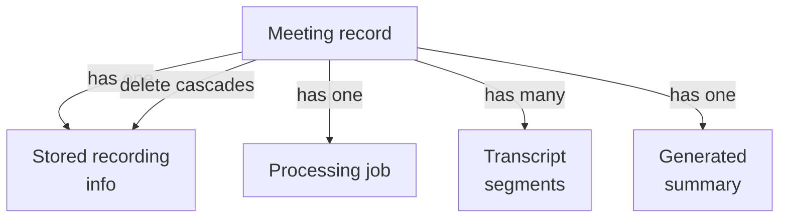
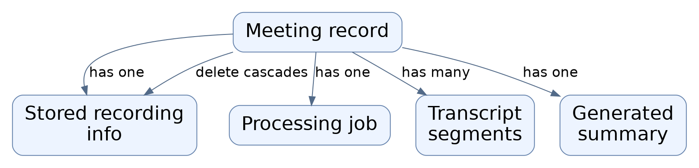
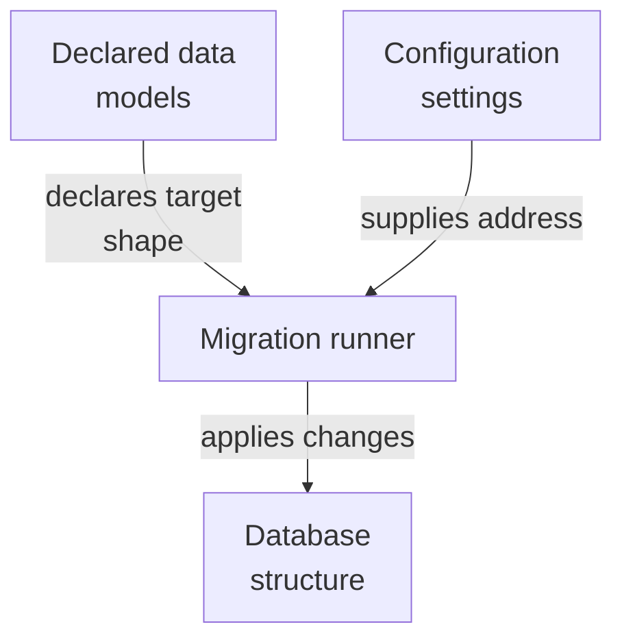
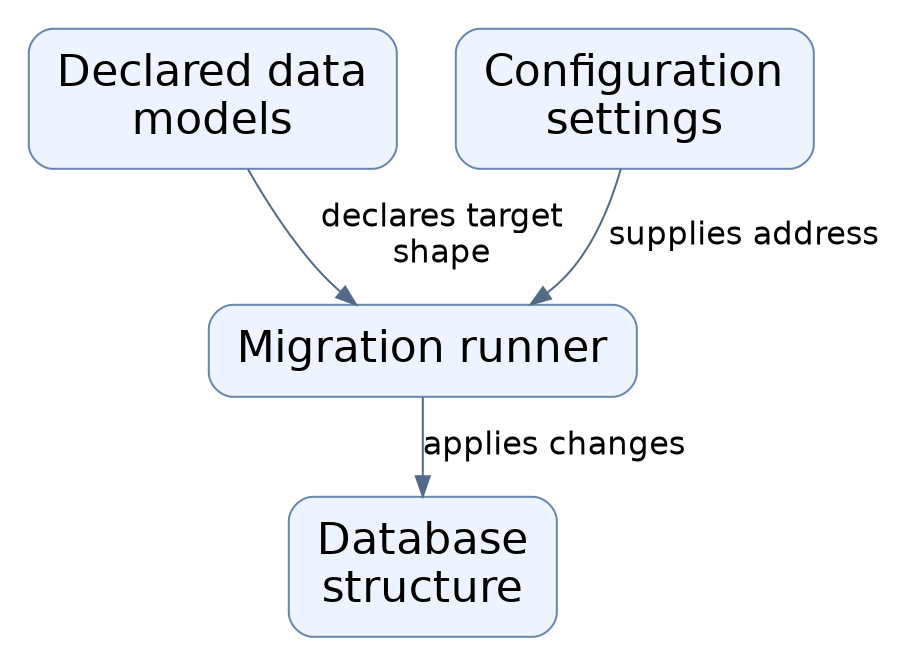
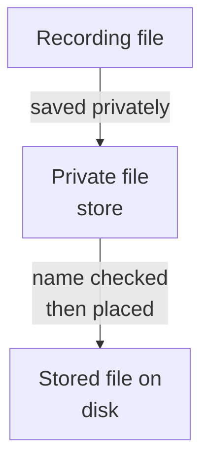
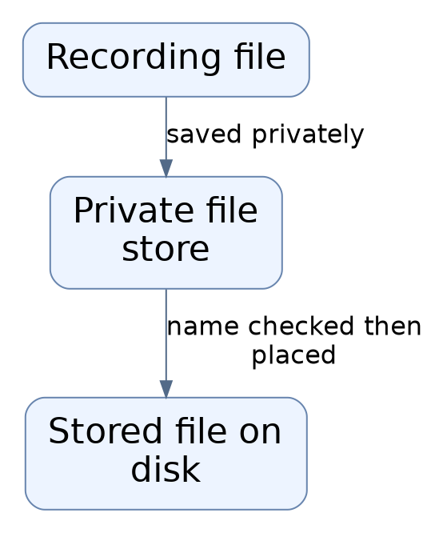
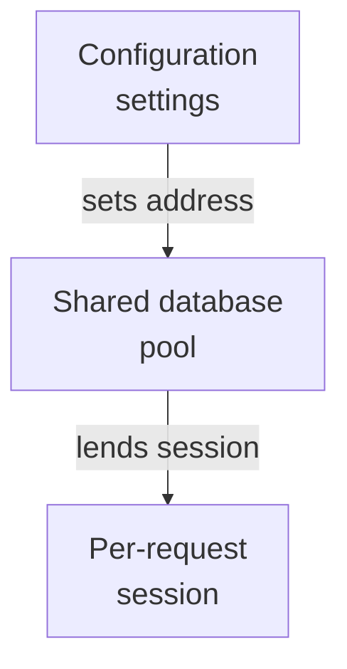
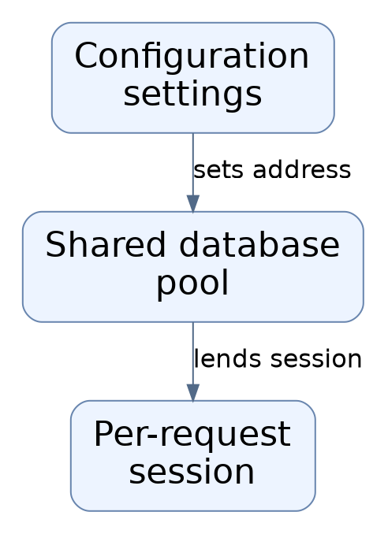
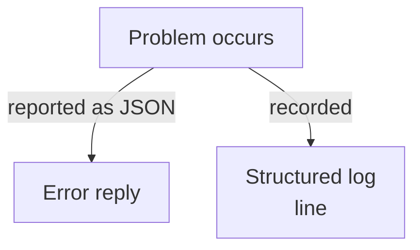
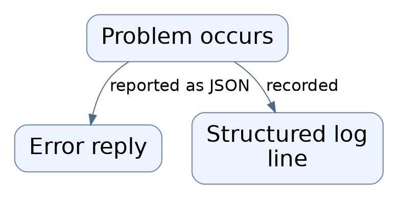

# Repository map

This area stores and protects the data behind a meeting-notes service: meetings, their uploaded recordings, transcription jobs, transcript text, and generated summaries. It also sets up database structure, private file storage, error replies, and structured logs. Most pieces are foundations (schema, settings, storage); the actual web endpoints and background workers are not shown here.

Commit: `3f279169c3843b77bf5932f79bb601f7bff74120` | Generated: 2026-10-19T00:31:12.507589+00:00

[Open PDF](repository-map.pdf)

**AI-generated analysis. Source references are checked for existence and supplied scope; this does not prove semantic correctness.**

## Scope

Tracked, eligible text only; bounded excerpts, not exhaustive.

21/21 eligible files analyzed; 81 tracked files excluded by policy.

3 API calls. See coverage.json for budgets, exclusions, and usage.

## How a meeting's notes data is organized

A meeting is the central record. Its recording, processing job, transcript pieces, and summary all belong to it, and removing the meeting removes them all.

PNG fallback

Read from top to bottom; arrows show what happens next or what is passed along.

### Source evidence

- **F0005**: A Meetings table stores owner, title, lifecycle status constrained to draft/uploading/queued/transcribing/summarizing/ready/failed/deleted, timing fields, consent confirmation timestamp and policy version, and soft-delete deleted_at; an index on (owner_id, created_at, id) supports per-owner listing. (<a href="https://github.com/Justin-Mendoza/AI-Notetaker/blob/3f279169c3843b77bf5932f79bb601f7bff74120/apps/api/alembic/versions/0001_meetings.py#L1-L45">apps/api/alembic/versions/0001_meetings.py:1-45</a>, <a href="https://github.com/Justin-Mendoza/AI-Notetaker/blob/3f279169c3843b77bf5932f79bb601f7bff74120/apps/api/app/models/meeting.py#L1-L39">apps/api/app/models/meeting.py:1-39</a>)
- **F0006**: A Recordings table links one-to-one to a meeting (unique meeting_id, cascade delete) and records the stored object key, mime type, size (bounded to 100 MB), sha256, an upload idempotency key, upload timestamp, and purge_after for later deletion. (<a href="https://github.com/Justin-Mendoza/AI-Notetaker/blob/3f279169c3843b77bf5932f79bb601f7bff74120/apps/api/alembic/versions/0002_recordings_jobs.py#L1-L71">apps/api/alembic/versions/0002_recordings_jobs.py:1-71</a>, <a href="https://github.com/Justin-Mendoza/AI-Notetaker/blob/3f279169c3843b77bf5932f79bb601f7bff74120/apps/api/app/models/recording.py#L1-L27">apps/api/app/models/recording.py:1-27</a>)
- **F0007**: A ProcessingJobs table is one-to-one with a meeting and tracks worker leasing and retries: kind, stage, status constrained to pending/running/failed/completed, attempts vs max_attempts, run_after, lease_until, locked_by, last_error_code, plus an index on (status, run_after) that supports claiming due jobs. (<a href="https://github.com/Justin-Mendoza/AI-Notetaker/blob/3f279169c3843b77bf5932f79bb601f7bff74120/apps/api/alembic/versions/0002_recordings_jobs.py#L1-L71">apps/api/alembic/versions/0002_recordings_jobs.py:1-71</a>, <a href="https://github.com/Justin-Mendoza/AI-Notetaker/blob/3f279169c3843b77bf5932f79bb601f7bff74120/apps/api/app/models/job.py#L1-L37">apps/api/app/models/job.py:1-37</a>)
- **F0008**: Job retry bookkeeping was extended with manual_retry_count and manual_retry_window_at columns, described as tracking manual retry rate limits. (<a href="https://github.com/Justin-Mendoza/AI-Notetaker/blob/3f279169c3843b77bf5932f79bb601f7bff74120/apps/api/alembic/versions/0005_retry_limits.py#L1-L29">apps/api/alembic/versions/0005_retry_limits.py:1-29</a>, <a href="https://github.com/Justin-Mendoza/AI-Notetaker/blob/3f279169c3843b77bf5932f79bb601f7bff74120/apps/api/app/models/job.py#L1-L37">apps/api/app/models/job.py:1-37</a>)
- **F0009**: A cursor column on processing_jobs (added with the transcript stage, defaulting stage to 'transcribing' and cursor to 0) provides resumable progress tracking through transcription. (<a href="https://github.com/Justin-Mendoza/AI-Notetaker/blob/3f279169c3843b77bf5932f79bb601f7bff74120/apps/api/alembic/versions/0003_transcript.py#L1-L50">apps/api/alembic/versions/0003_transcript.py:1-50</a>, <a href="https://github.com/Justin-Mendoza/AI-Notetaker/blob/3f279169c3843b77bf5932f79bb601f7bff74120/apps/api/app/models/job.py#L1-L37">apps/api/app/models/job.py:1-37</a>)
- **F0010**: A TranscriptSegments table stores ordered, timestamped transcript text per meeting, with a unique (meeting_id, sequence_no) constraint and checks that sequence is non-negative and end_ms &gt; start_ms, and it records the provider and model that produced each segment. (<a href="https://github.com/Justin-Mendoza/AI-Notetaker/blob/3f279169c3843b77bf5932f79bb601f7bff74120/apps/api/alembic/versions/0003_transcript.py#L1-L50">apps/api/alembic/versions/0003_transcript.py:1-50</a>, <a href="https://github.com/Justin-Mendoza/AI-Notetaker/blob/3f279169c3843b77bf5932f79bb601f7bff74120/apps/api/app/models/transcript.py#L1-L37">apps/api/app/models/transcript.py:1-37</a>)
- **F0011**: A Summaries table stores one validated summary per meeting as JSON content alongside schema_version, prompt_version, and model metadata, indicating summaries are versioned against both prompt and output schema. (<a href="https://github.com/Justin-Mendoza/AI-Notetaker/blob/3f279169c3843b77bf5932f79bb601f7bff74120/apps/api/alembic/versions/0004_summaries.py#L1-L38">apps/api/alembic/versions/0004_summaries.py:1-38</a>, <a href="https://github.com/Justin-Mendoza/AI-Notetaker/blob/3f279169c3843b77bf5932f79bb601f7bff74120/apps/api/app/models/summary.py#L1-L22">apps/api/app/models/summary.py:1-22</a>)
- **F0014**: The cascade-delete foreign keys from recordings, processing_jobs, transcript_segments, and summaries to meetings mean removing a meeting row also removes its media metadata, job, transcript, and summary rows. (<a href="https://github.com/Justin-Mendoza/AI-Notetaker/blob/3f279169c3843b77bf5932f79bb601f7bff74120/apps/api/alembic/versions/0002_recordings_jobs.py#L1-L71">apps/api/alembic/versions/0002_recordings_jobs.py:1-71</a>, <a href="https://github.com/Justin-Mendoza/AI-Notetaker/blob/3f279169c3843b77bf5932f79bb601f7bff74120/apps/api/alembic/versions/0003_transcript.py#L1-L50">apps/api/alembic/versions/0003_transcript.py:1-50</a>, <a href="https://github.com/Justin-Mendoza/AI-Notetaker/blob/3f279169c3843b77bf5932f79bb601f7bff74120/apps/api/alembic/versions/0004_summaries.py#L1-L38">apps/api/alembic/versions/0004_summaries.py:1-38</a>, <a href="https://github.com/Justin-Mendoza/AI-Notetaker/blob/3f279169c3843b77bf5932f79bb601f7bff74120/apps/api/app/models/recording.py#L1-L27">apps/api/app/models/recording.py:1-27</a>, <a href="https://github.com/Justin-Mendoza/AI-Notetaker/blob/3f279169c3843b77bf5932f79bb601f7bff74120/apps/api/app/models/summary.py#L1-L22">apps/api/app/models/summary.py:1-22</a>, <a href="https://github.com/Justin-Mendoza/AI-Notetaker/blob/3f279169c3843b77bf5932f79bb601f7bff74120/apps/api/app/models/transcript.py#L1-L37">apps/api/app/models/transcript.py:1-37</a>)

## How the database structure is kept in step

The migration tool reads the declared data models as its target shape and the configured database address, then either prints the SQL or applies it to a live database.

PNG fallback

Read from top to bottom; arrows show what happens next or what is passed along.

### Source evidence

- **F0001**: Alembic migration environment loads the application's ORM metadata (Base.metadata from app.db.base) as the migration target and reads the database URL from application settings, so migrations are generated/applied against the same schema the models declare. (<a href="https://github.com/Justin-Mendoza/AI-Notetaker/blob/3f279169c3843b77bf5932f79bb601f7bff74120/apps/api/alembic/env.py#L1-L49">apps/api/alembic/env.py:1-49</a>, <a href="https://github.com/Justin-Mendoza/AI-Notetaker/blob/3f279169c3843b77bf5932f79bb601f7bff74120/apps/api/app/db/base.py#L1-L5">apps/api/app/db/base.py:1-5</a>)
- **F0002**: Migration env imports all model modules (ProcessingJob, Meeting, Recording, Summary, TranscriptSegment) solely so their tables register on Base.metadata; this is import-time registration, not evidence of runtime query usage. (<a href="https://github.com/Justin-Mendoza/AI-Notetaker/blob/3f279169c3843b77bf5932f79bb601f7bff74120/apps/api/alembic/env.py#L1-L49">apps/api/alembic/env.py:1-49</a>)
- **F0003**: Migration env supports two modes: offline (run_migrations_offline emits SQL with literal bound parameters against settings.database_url) and online (run_migrations_online builds an engine from the Alembic config section and runs against a live connection). (<a href="https://github.com/Justin-Mendoza/AI-Notetaker/blob/3f279169c3843b77bf5932f79bb601f7bff74120/apps/api/alembic/env.py#L1-L49">apps/api/alembic/env.py:1-49</a>)
- **F0027**: Settings is a frozen dataclass populated at import time from environment variables via load_dotenv(), exposing database_url, allowed_web_origin, local_recording_dir, provider keys (openai_api_key, kyma_api_key), STT model/provider selectors, summary provider/model selectors, local Whisper and Cohere base URLs and model labels, retention hours/days, and per-hour rate limits (max_meetings_per_hour, max_uploads_per_hour, max_manual_retries_per_hour) and metrics_token. (<a href="https://github.com/Justin-Mendoza/AI-Notetaker/blob/3f279169c3843b77bf5932f79bb601f7bff74120/apps/api/app/settings.py#L1-L38">apps/api/app/settings.py:1-38</a>)

## How recordings are kept privately on disk

Recordings are saved as private files under one configured folder. Each file name must match a strict pattern, saving happens atomically, and reading or listing is offered for later use.

PNG fallback

Read from top to bottom; arrows show what happens next or what is passed along.

### Source evidence

- **F0006**: A Recordings table links one-to-one to a meeting (unique meeting_id, cascade delete) and records the stored object key, mime type, size (bounded to 100 MB), sha256, an upload idempotency key, upload timestamp, and purge_after for later deletion. (<a href="https://github.com/Justin-Mendoza/AI-Notetaker/blob/3f279169c3843b77bf5932f79bb601f7bff74120/apps/api/alembic/versions/0002_recordings_jobs.py#L1-L71">apps/api/alembic/versions/0002_recordings_jobs.py:1-71</a>, <a href="https://github.com/Justin-Mendoza/AI-Notetaker/blob/3f279169c3843b77bf5932f79bb601f7bff74120/apps/api/app/models/recording.py#L1-L27">apps/api/app/models/recording.py:1-27</a>)
- **F0022**: Storage.upload copies a source file into a temporary file in the destination's parent directory, chmods it to 0o600, then atomically os.replace's it into place; OSError during the copy raises ApiError 503 STORAGE_UPLOAD_FAILED, and the temporary file is always unlinked in finally. (<a href="https://github.com/Justin-Mendoza/AI-Notetaker/blob/3f279169c3843b77bf5932f79bb601f7bff74120/apps/api/app/services/storage.py#L1-L79">apps/api/app/services/storage.py:1-79</a>)
- **F0020**: Storage stores recordings as private files on the local filesystem under a configurable root (settings.local_recording_dir, else &lt;app&gt;/.data/recordings), creating/chmodding the root to mode 0o700 in __init__. (<a href="https://github.com/Justin-Mendoza/AI-Notetaker/blob/3f279169c3843b77bf5932f79bb601f7bff74120/apps/api/app/services/storage.py#L1-L79">apps/api/app/services/storage.py:1-79</a>, <a href="https://github.com/Justin-Mendoza/AI-Notetaker/blob/3f279169c3843b77bf5932f79bb601f7bff74120/apps/api/app/settings.py#L1-L38">apps/api/app/settings.py:1-38</a>)
- **F0021**: Object keys are constrained by OBJECT_KEY, a regex requiring a UUID/UUID/UUID.ext layout with an allowed audio extension (webm, ogg, m4a, wav, mp3). _path validates the key against this regex and additionally rejects paths that escape the root, raising ApiError 500 STORAGE_KEY_INVALID otherwise. (<a href="https://github.com/Justin-Mendoza/AI-Notetaker/blob/3f279169c3843b77bf5932f79bb601f7bff74120/apps/api/app/services/storage.py#L1-L79">apps/api/app/services/storage.py:1-79</a>)

## How database sessions reach request handlers

One shared connection pool is built from configuration, and each incoming request borrows a session and returns it when finished.

PNG fallback

Read from top to bottom; arrows show what happens next or what is passed along.

### Source evidence

- **F0027**: Settings is a frozen dataclass populated at import time from environment variables via load_dotenv(), exposing database_url, allowed_web_origin, local_recording_dir, provider keys (openai_api_key, kyma_api_key), STT model/provider selectors, summary provider/model selectors, local Whisper and Cohere base URLs and model labels, retention hours/days, and per-hour rate limits (max_meetings_per_hour, max_uploads_per_hour, max_manual_retries_per_hour) and metrics_token. (<a href="https://github.com/Justin-Mendoza/AI-Notetaker/blob/3f279169c3843b77bf5932f79bb601f7bff74120/apps/api/app/settings.py#L1-L38">apps/api/app/settings.py:1-38</a>)
- **F0028**: A module-level singleton `settings = Settings()` is created at import, so configuration is read once per process and later environment changes are not reflected. (<a href="https://github.com/Justin-Mendoza/AI-Notetaker/blob/3f279169c3843b77bf5932f79bb601f7bff74120/apps/api/app/settings.py#L1-L38">apps/api/app/settings.py:1-38</a>)
- **F0004**: Database access is provided through a SQLAlchemy engine created from settings.database_url with pool_pre_ping enabled and a session factory (SessionLocal) with autoflush disabled; get_db yields a session per request via a generator. (<a href="https://github.com/Justin-Mendoza/AI-Notetaker/blob/3f279169c3843b77bf5932f79bb601f7bff74120/apps/api/app/db/session.py#L1-L14">apps/api/app/db/session.py:1-14</a>)

## How failures are reported and logged

When something goes wrong, the service returns a small JSON error containing a code, message, and request reference. Logs are written as single-line JSON with only approved fields.

PNG fallback

Read from top to bottom; arrows show what happens next or what is passed along.

### Source evidence

- **F0012**: API errors are returned as JSON with a nested error object containing code, message, and request_id; unhandled ApiError maps to its own status/code, while FastAPI request-validation failures map to HTTP 422 with code INVALID_INPUT. (<a href="https://github.com/Justin-Mendoza/AI-Notetaker/blob/3f279169c3843b77bf5932f79bb601f7bff74120/apps/api/app/errors.py#L1-L28">apps/api/app/errors.py:1-28</a>)
- **F0013** (inferred): The error_response helper derives the request_id from request.state.request_id, falling back to a freshly generated UUID when absent, implying request-id middleware exists elsewhere to populate request.state. (<a href="https://github.com/Justin-Mendoza/AI-Notetaker/blob/3f279169c3843b77bf5932f79bb601f7bff74120/apps/api/app/errors.py#L1-L28">apps/api/app/errors.py:1-28</a>)
- **F0017**: JsonFormatter renders each log record as a compact JSON object containing a UTC ISO timestamp derived from the record's creation time, the log level name, and the formatted message under the key 'event'. (<a href="https://github.com/Justin-Mendoza/AI-Notetaker/blob/3f279169c3843b77bf5932f79bb601f7bff74120/apps/api/app/observability.py#L1-L40">apps/api/app/observability.py:1-40</a>)
- **F0018**: JsonFormatter only copies an allow-listed set of metadata fields (request_id, meeting_id, job_id, stage, duration_ms, provider, attempt, error_code, status_code) from the LogRecord; fields whose value is None are omitted, and any field ending in '_id' is stringified. This limits what log output can carry but is the mechanism that avoids emitting unselected metadata. (<a href="https://github.com/Justin-Mendoza/AI-Notetaker/blob/3f279169c3843b77bf5932f79bb601f7bff74120/apps/api/app/observability.py#L1-L40">apps/api/app/observability.py:1-40</a>)
- **F0019**: configure_logging sets the root logger level to INFO, installs a single StreamHandler with JsonFormatter, and replaces the root handler list; a filter restricts emission to loggers whose name starts with 'app.', so records from other libraries are dropped by that handler. (<a href="https://github.com/Justin-Mendoza/AI-Notetaker/blob/3f279169c3843b77bf5932f79bb601f7bff74120/apps/api/app/observability.py#L1-L40">apps/api/app/observability.py:1-40</a>)

## Uncertainties and untraced areas

- No route handlers, background workers, or object-storage client appear in this batch, so the full request-to-notes flow cannot be confirmed here.
- It is inferred, not observed, that the API and worker processes share the same local recording folder (F0030).
- Where request.state.request_id is populated (presumed middleware) is not shown (F0013).
- External transcription and summarization providers and quota limits are configured but have no visible call sites in this batch (F0031).
- Whether any of the declared tables or storage functions are used at runtime cannot be confirmed from import-time registration alone (F0002).
- How often recordings are purged and which process performs deletion is not shown.
