# Repository map

This area is the background processing engine for a meeting-notes app. A separate worker process quietly picks up queued jobs, converts uploaded audio into text, and turns that text into structured class notes with topics, decisions, and action items. It also periodically deletes expired audio and abandoned drafts. Some provider wiring and the surrounding web endpoints are only partly shown.

Commit: `3f279169c3843b77bf5932f79bb601f7bff74120` | Generated: 2026-10-19T00:32:57.145597+00:00

[Open PDF](repository-map.pdf)

**AI-generated analysis. Source references are checked for existence and supplied scope; this does not prove semantic correctness.**

## Scope

Tracked, eligible text only; bounded excerpts, not exhaustive.

14/14 eligible files analyzed; 88 tracked files excluded by policy.

6 API calls. See coverage.json for budgets, exclusions, and usage.

## How a recording becomes meeting notes

A background worker process loops continuously, claiming one queued job at a time, transcribing and then summarizing it, and saving the outcome.

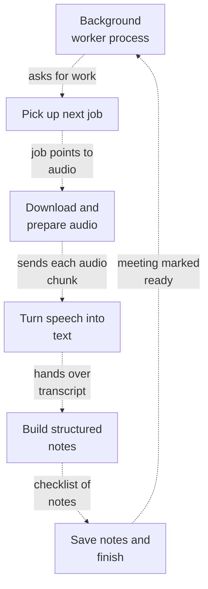

PNG fallback

Read from top to bottom. Dashed arrows show connections that need confirmation.

### Source evidence

- **F0001**: The worker entrypoint main() is a long-running process that configures logging, creates a unique worker_id from hostname plus a random UUID, instantiates storage, transcriber, and summarizer, then loops forever: it runs cleanup_once roughly hourly (catching and logging any cleanup exception as 'cleanup_failed') and calls run_once; when run_once returns falsey it sleeps 2 seconds before retrying. (<a href="https://github.com/Justin-Mendoza/AI-Notetaker/blob/3f279169c3843b77bf5932f79bb601f7bff74120/apps/api/app/worker/main.py#L1-L38">apps/api/app/worker/main.py:1-38</a>)
- **F0003**: The worker orchestrates background, non-HTTP work: it is the process that performs cleanup and job processing (run_once) using shared database sessions (SessionLocal), storage, a transcriber, and a summarizer. (<a href="https://github.com/Justin-Mendoza/AI-Notetaker/blob/3f279169c3843b77bf5932f79bb601f7bff74120/apps/api/app/worker/main.py#L1-L38">apps/api/app/worker/main.py:1-38</a>)
- **F0045**: The worker runner claims queued or expired processing jobs from the database: claim_job selects a ProcessingJob that is either pending and due, or running with an expired lease, using row locking (skip_locked), then marks it running, increments attempts, sets a lease deadline, and advances the related Meeting status to transcribing or summarizing based on the job stage. (<a href="https://github.com/Justin-Mendoza/AI-Notetaker/blob/3f279169c3843b77bf5932f79bb601f7bff74120/apps/api/app/worker/runner.py#L1-L496">apps/api/app/worker/runner.py:1-496</a>)
- **F0046**: A worker process can recover the meeting-notes pipeline across restarts: run_once claims one job, logs its details, wires storage and transcriber dependencies, and, when heartbeat is enabled, runs process_job under a LeaseHeartbeat that periodically renews the job lease. (<a href="https://github.com/Justin-Mendoza/AI-Notetaker/blob/3f279169c3843b77bf5932f79bb601f7bff74120/apps/api/app/worker/runner.py#L1-L496">apps/api/app/worker/runner.py:1-496</a>)
- **F0056**: process_job for the transcribing stage downloads the recording audio from storage into a temporary directory, verifies the downloaded content's SHA-256 against the stored recording hash (INVALID_AUDIO if mismatched), and maps storage read failures to transient STORAGE_READ_FAILED. (<a href="https://github.com/Justin-Mendoza/AI-Notetaker/blob/3f279169c3843b77bf5932f79bb601f7bff74120/apps/api/app/worker/runner.py#L1-L496">apps/api/app/worker/runner.py:1-496</a>)
- **F0057**: After download, process_job inspects the audio duration (mapping a 413 error to non-transient LIMIT_EXCEEDED, other ApiError to INVALID_AUDIO), splits it into chunks, and fails non-transiently if splitting raises or yields no chunks. (<a href="https://github.com/Justin-Mendoza/AI-Notetaker/blob/3f279169c3843b77bf5932f79bb601f7bff74120/apps/api/app/worker/runner.py#L1-L496">apps/api/app/worker/runner.py:1-496</a>)
- **F0035**: The audio worker normalizes source audio through ffmpeg to mono 16 kHz 32kbps MP3, then splits it into ~10-minute chunks (CHUNK_MS) capped under MAX_STT_BYTES, returning AudioChunk records with sequence number and millisecond start/end. (<a href="https://github.com/Justin-Mendoza/AI-Notetaker/blob/3f279169c3843b77bf5932f79bb601f7bff74120/apps/api/app/worker/audio.py#L1-L88">apps/api/app/worker/audio.py:1-88</a>)
- **F0017**: The transcription service turns an audio file at a filesystem path into a plain text transcript. A Transcriber protocol defines one method, transcribe(path), and provider classes implement it; the result is the stripped transcript string. It is the input step of the meeting-notes pipeline, fed by the background worker rather than by an HTTP request in this excerpt. (<a href="https://github.com/Justin-Mendoza/AI-Notetaker/blob/3f279169c3843b77bf5932f79bb601f7bff74120/apps/api/app/services/transcription.py#L1-L126">apps/api/app/services/transcription.py:1-126</a>)
- **F0018**: create_transcriber selects the speech-to-text provider from settings.stt_provider, supporting 'cohere_local', 'openai', and 'whisper_local'; an unknown value raises TranscriptionError('STT_PROVIDER_INVALID', transient=False). This is a configuration-driven choice of external system, made at construction time. (<a href="https://github.com/Justin-Mendoza/AI-Notetaker/blob/3f279169c3843b77bf5932f79bb601f7bff74120/apps/api/app/services/transcription.py#L1-L126">apps/api/app/services/transcription.py:1-126</a>)
- **F0058**: For each chunk not already present, process_job calls the transcriber, wraps TranscriptionError into a ProcessingFailure preserving code and transience, and saves the segment; for live-capture jobs it uses split_audio with 60-second chunks and computes the required final count from the maximum of chunk count and existing segment count. (<a href="https://github.com/Justin-Mendoza/AI-Notetaker/blob/3f279169c3843b77bf5932f79bb601f7bff74120/apps/api/app/worker/runner.py#L1-L496">apps/api/app/worker/runner.py:1-496</a>)
- **F0021**: The summarization service converts a list of timestamped transcript segments into structured class notes: an overview, key_points, topics (heading, summary, key_details, evidence ids), decisions, action_items (task, owner, due date), and open_questions. A SummaryContent model with extra fields forbidden enforces the shape, and validate_summary rejects any topic/decision/action whose evidence ids are empty or not a subset of the allowed segment ids (SUMMARY_INVALID / SUMMARY_EVIDENCE_INVALID). This is the output-producing step of the pipeline. (<a href="https://github.com/Justin-Mendoza/AI-Notetaker/blob/3f279169c3843b77bf5932f79bb601f7bff74120/apps/api/app/services/summarization.py#L1-L367">apps/api/app/services/summarization.py:1-367</a>)
- **F0053**: process_job for the summarizing stage loads contiguous transcript segments into SummarySegment inputs, ensures they cover the job cursor (TRANSCRIPT_INCOMPLETE otherwise), runs the summarizer, wraps SummaryError into a ProcessingFailure, and persists the result via save_summary. (<a href="https://github.com/Justin-Mendoza/AI-Notetaker/blob/3f279169c3843b77bf5932f79bb601f7bff74120/apps/api/app/worker/runner.py#L1-L496">apps/api/app/worker/runner.py:1-496</a>)
- **F0055**: save_summary validates the summary content against the set of known transcript segment IDs, then inserts or updates the Summary row (schema/prompt versions, model, content JSON) and marks the job completed and the meeting ready. (<a href="https://github.com/Justin-Mendoza/AI-Notetaker/blob/3f279169c3843b77bf5932f79bb601f7bff74120/apps/api/app/worker/runner.py#L1-L496">apps/api/app/worker/runner.py:1-496</a>)
- **F0052**: complete_transcription verifies the stored transcript segments form a contiguous sequence 0..count-1 (raising TRANSCRIPT_INCOMPLETE otherwise) and that a Recording exists (MISSING_RECORDING), then transitions the job to the summarizing stage/pending and sets the recording's purge_after based on raw_audio_retention_hours. (<a href="https://github.com/Justin-Mendoza/AI-Notetaker/blob/3f279169c3843b77bf5932f79bb601f7bff74120/apps/api/app/worker/runner.py#L1-L496">apps/api/app/worker/runner.py:1-496</a>)

## Keeping the job safe while it runs

Shows how the worker holds onto a claimed job, renews its lease, checks the job is still valid mid-summarization, and copies queued transcripts back onto TranscriptSegment rows so retries are safe.

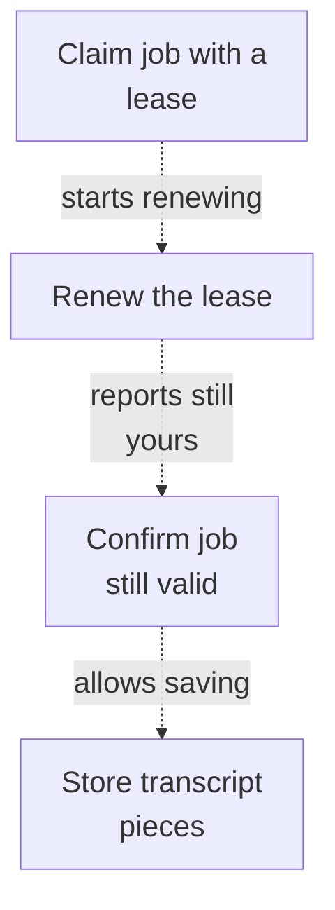

PNG fallback

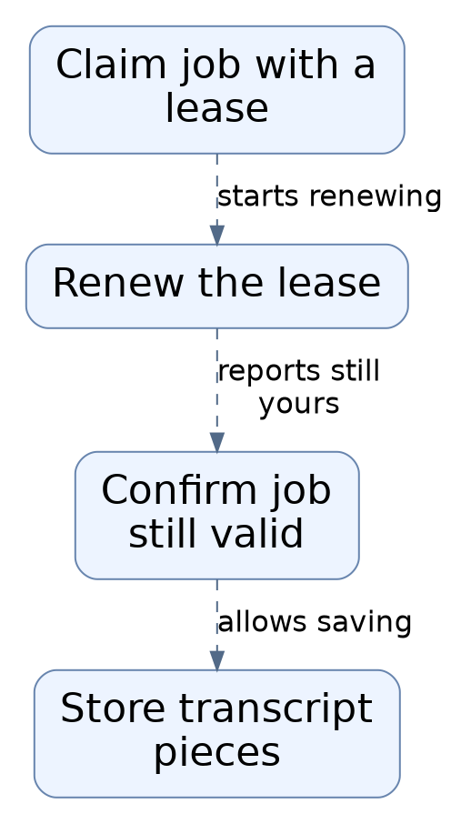

Read from top to bottom. Dashed arrows show connections that need confirmation.

### Source evidence

- **F0045**: The worker runner claims queued or expired processing jobs from the database: claim_job selects a ProcessingJob that is either pending and due, or running with an expired lease, using row locking (skip_locked), then marks it running, increments attempts, sets a lease deadline, and advances the related Meeting status to transcribing or summarizing based on the job stage. (<a href="https://github.com/Justin-Mendoza/AI-Notetaker/blob/3f279169c3843b77bf5932f79bb601f7bff74120/apps/api/app/worker/runner.py#L1-L496">apps/api/app/worker/runner.py:1-496</a>)
- **F0047**: LeaseHeartbeat runs a daemon thread that renews the job lease every LEASE_SECONDS/3; if renewal fails or raises, the loop silently stops, and the heartbeat is stopped and joined when the context exits. (<a href="https://github.com/Justin-Mendoza/AI-Notetaker/blob/3f279169c3843b77bf5932f79bb601f7bff74120/apps/api/app/worker/runner.py#L1-L496">apps/api/app/worker/runner.py:1-496</a>)
- **F0048**: ensure_active re-reads the job row to confirm it is still running, still owned by this worker, and has an unexpired lease, raising LeaseLost if not; it also loads the meeting and raises JobCancelled if the meeting is missing or soft-deleted. (<a href="https://github.com/Justin-Mendoza/AI-Notetaker/blob/3f279169c3843b77bf5932f79bb601f7bff74120/apps/api/app/worker/runner.py#L1-L496">apps/api/app/worker/runner.py:1-496</a>)
- **F0054**: When using OpenAISummarizer, process_job attaches a check_active callback so the summarizer can periodically confirm the job lease is still valid mid-summarization. (<a href="https://github.com/Justin-Mendoza/AI-Notetaker/blob/3f279169c3843b77bf5932f79bb601f7bff74120/apps/api/app/worker/runner.py#L1-L496">apps/api/app/worker/runner.py:1-496</a>)
- **F0051**: Each transcribed audio chunk is persisted as a TranscriptSegment using a dialect-specific upsert that does nothing on conflict (PostgreSQL constraint uq_transcript_sequence, SQLite meeting_id/sequence_no), and advances the job cursor. Unsupported database dialects raise a non-transient ProcessingFailure UNSUPPORTED_DATABASE. (<a href="https://github.com/Justin-Mendoza/AI-Notetaker/blob/3f279169c3843b77bf5932f79bb601f7bff74120/apps/api/app/worker/runner.py#L1-L496">apps/api/app/worker/runner.py:1-496</a>)
- **F0052**: complete_transcription verifies the stored transcript segments form a contiguous sequence 0..count-1 (raising TRANSCRIPT_INCOMPLETE otherwise) and that a Recording exists (MISSING_RECORDING), then transitions the job to the summarizing stage/pending and sets the recording's purge_after based on raw_audio_retention_hours. (<a href="https://github.com/Justin-Mendoza/AI-Notetaker/blob/3f279169c3843b77bf5932f79bb601f7bff74120/apps/api/app/worker/runner.py#L1-L496">apps/api/app/worker/runner.py:1-496</a>)
- **F0046**: A worker process can recover the meeting-notes pipeline across restarts: run_once claims one job, logs its details, wires storage and transcriber dependencies, and, when heartbeat is enabled, runs process_job under a LeaseHeartbeat that periodically renews the job lease. (<a href="https://github.com/Justin-Mendoza/AI-Notetaker/blob/3f279169c3843b77bf5932f79bb601f7bff74120/apps/api/app/worker/runner.py#L1-L496">apps/api/app/worker/runner.py:1-496</a>)

## What happens when a job fails

Failures are classified as temporary or permanent. Temporary ones wait and retry with growing delays; permanent ones mark both the job and the meeting as failed.

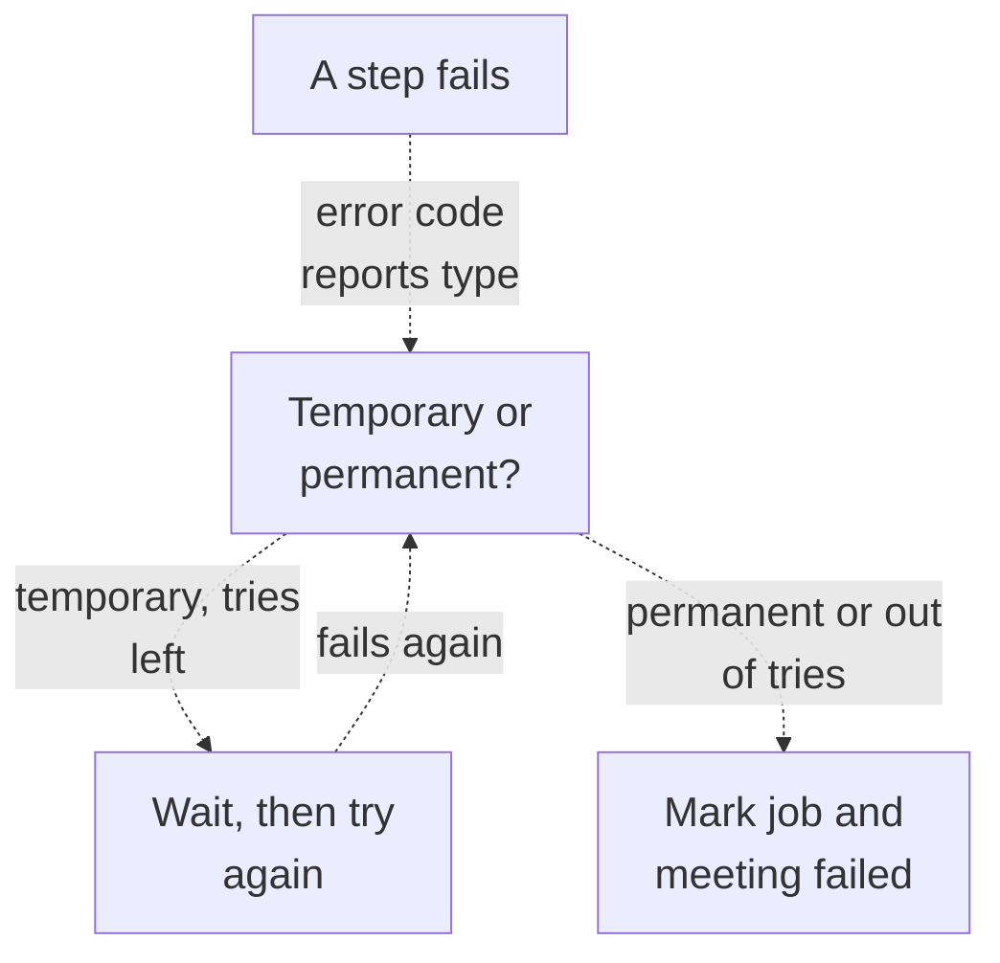

PNG fallback

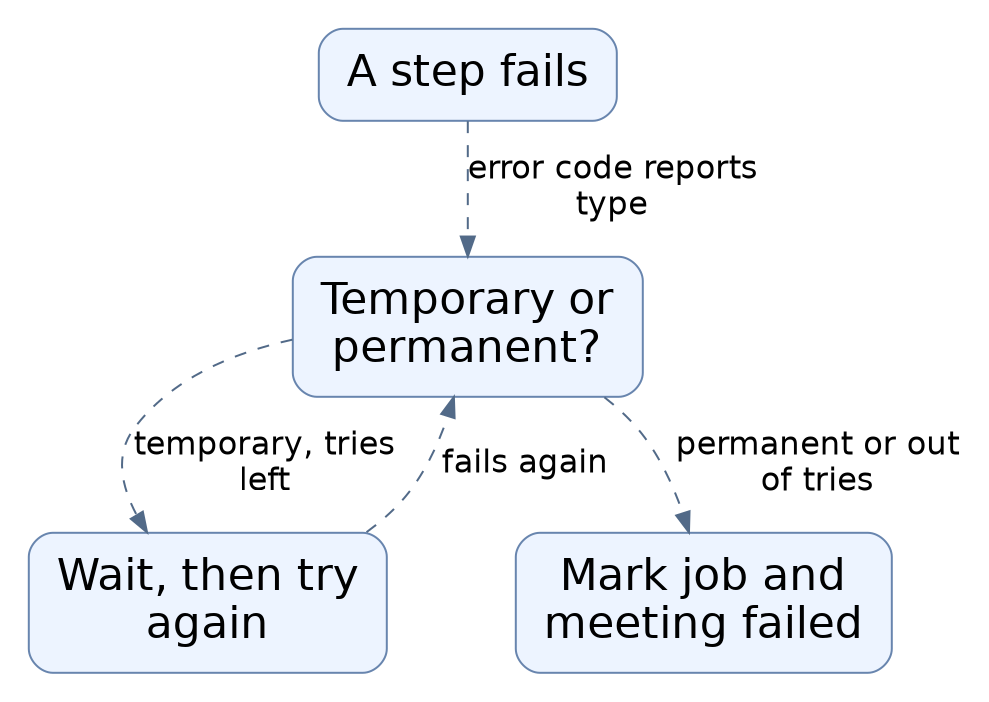

Read from top to bottom. Dashed arrows show connections that need confirmation.

### Source evidence

- **F0030**: Both provider layers classify failures as transient or not through error codes carrying a transient boolean (TranscriptionError, SummaryError), letting callers decide retry versus permanent failure. Examples include SUMMARY_TEMPORARY/STT_TEMPORARY, SUMMARY_REJECTED/STT_REJECTED, SUMMARY_INCOMPLETE, SUMMARY_REFUSED, and provider-unavailable errors that are non-transient. This is the failure surface exposed to the (unshown) worker. (<a href="https://github.com/Justin-Mendoza/AI-Notetaker/blob/3f279169c3843b77bf5932f79bb601f7bff74120/apps/api/app/services/summarization.py#L1-L367">apps/api/app/services/summarization.py:1-367</a>, <a href="https://github.com/Justin-Mendoza/AI-Notetaker/blob/3f279169c3843b77bf5932f79bb601f7bff74120/apps/api/app/services/transcription.py#L1-L126">apps/api/app/services/transcription.py:1-126</a>)
- **F0060**: The module's error model distinguishes exceptions by outcome: LeaseLost, JobCancelled, and ProcessingFailure each carry a code and a transient flag; the transient flag drives whether mark_failure retries or permanently fails the job. (<a href="https://github.com/Justin-Mendoza/AI-Notetaker/blob/3f279169c3843b77bf5932f79bb601f7bff74120/apps/api/app/worker/runner.py#L1-L496">apps/api/app/worker/runner.py:1-496</a>)
- **F0059**: mark_failure records a job's error code and either reschedules it (transient failure with remaining attempts, setting status pending with exponential backoff capped at 300 seconds plus jitter) or marks both job and meeting failed, but only if the job is still running and owned by this worker. (<a href="https://github.com/Justin-Mendoza/AI-Notetaker/blob/3f279169c3843b77bf5932f79bb601f7bff74120/apps/api/app/worker/runner.py#L1-L496">apps/api/app/worker/runner.py:1-496</a>)
- **F0049**: claim_job treats certain jobs as non-actionable: if the meeting is missing or deleted it completes the job, and if an expired running job has already reached max_attempts it fails both the job (WORKER_TIMEOUT) and the meeting. (<a href="https://github.com/Justin-Mendoza/AI-Notetaker/blob/3f279169c3843b77bf5932f79bb601f7bff74120/apps/api/app/worker/runner.py#L1-L496">apps/api/app/worker/runner.py:1-496</a>)

## Hourly housekeeping

Every hour the same worker separately runs maintenance: expires abandoned uploads, deletes soft-deleted meetings and their stored objects, purges audio past its retention date, and clears orphaned files.

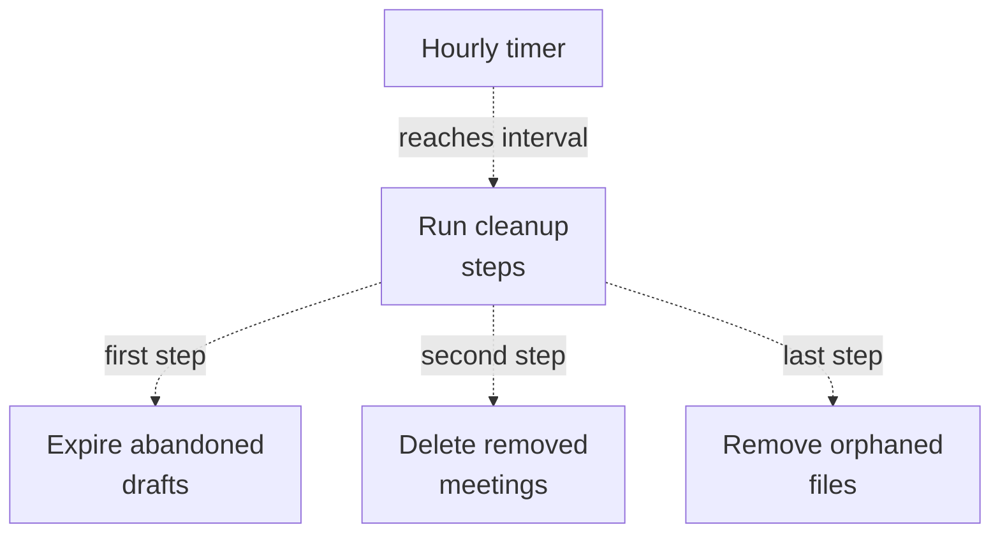

PNG fallback

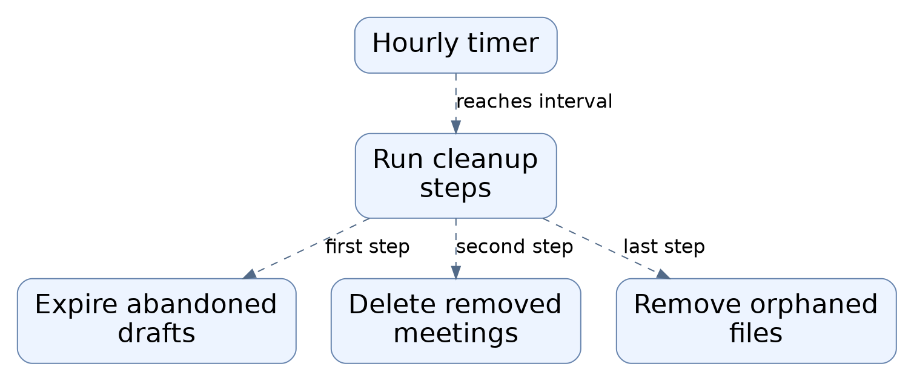

Read from top to bottom. Dashed arrows show connections that need confirmation.

### Source evidence

- **F0001**: The worker entrypoint main() is a long-running process that configures logging, creates a unique worker_id from hostname plus a random UUID, instantiates storage, transcriber, and summarizer, then loops forever: it runs cleanup_once roughly hourly (catching and logging any cleanup exception as 'cleanup_failed') and calls run_once; when run_once returns falsey it sleeps 2 seconds before retrying. (<a href="https://github.com/Justin-Mendoza/AI-Notetaker/blob/3f279169c3843b77bf5932f79bb601f7bff74120/apps/api/app/worker/main.py#L1-L38">apps/api/app/worker/main.py:1-38</a>)
- **F0004**: cleanup runs on a fixed interval CLEANUP_INTERVAL_SECONDS = 60*60 and is isolated from the main job loop via try/except so a cleanup failure does not stop processing. (<a href="https://github.com/Justin-Mendoza/AI-Notetaker/blob/3f279169c3843b77bf5932f79bb601f7bff74120/apps/api/app/worker/main.py#L1-L38">apps/api/app/worker/main.py:1-38</a>)
- **F0041**: cleanup_once sequentially runs expire_abandoned_meetings, cleanup_deleted_meetings, purge_expired_audio, and sweep_orphaned_objects, returning counts by category; main() wires it to the real SessionLocal factory and get_storage(). (<a href="https://github.com/Justin-Mendoza/AI-Notetaker/blob/3f279169c3843b77bf5932f79bb601f7bff74120/apps/api/app/worker/cleanup.py#L1-L146">apps/api/app/worker/cleanup.py:1-146</a>)
- **F0038**: The cleanup module performs idempotent maintenance over meetings and audio: expiring abandoned draft/uploading meetings after 7 days, deleting soft-deleted meetings and their summaries/transcript segments/jobs/recording rows and stored objects, purging recordings past purge_after, and sweeping orphaned storage objects. (<a href="https://github.com/Justin-Mendoza/AI-Notetaker/blob/3f279169c3843b77bf5932f79bb601f7bff74120/apps/api/app/worker/cleanup.py#L1-L146">apps/api/app/worker/cleanup.py:1-146</a>)
- **F0040**: Cleanup uses per-item sessions and skips items on storage.delete exceptions, so a single failed deletion does not abort the sweep; deleted rows are removed only after the object deletion succeeds for deleted meetings. (<a href="https://github.com/Justin-Mendoza/AI-Notetaker/blob/3f279169c3843b77bf5932f79bb601f7bff74120/apps/api/app/worker/cleanup.py#L1-L146">apps/api/app/worker/cleanup.py:1-146</a>)
- **F0039**: sweep_orphaned_objects only deletes storage keys matching a UUID/UUID/UUID.(webm|ogg|m4a|wav|mp3) pattern that are absent from Recording.object_key and older than min_age_hours (default 24), protecting unexpected keys. (<a href="https://github.com/Justin-Mendoza/AI-Notetaker/blob/3f279169c3843b77bf5932f79bb601f7bff74120/apps/api/app/worker/cleanup.py#L1-L146">apps/api/app/worker/cleanup.py:1-146</a>)
- **F0043**: Storage operations (delete, list_objects) and the Storage/get_storage abstraction are the boundary through which audio object bytes are created and removed; object keys are stored on Recording.object_key. (<a href="https://github.com/Justin-Mendoza/AI-Notetaker/blob/3f279169c3843b77bf5932f79bb601f7bff74120/apps/api/app/worker/cleanup.py#L1-L146">apps/api/app/worker/cleanup.py:1-146</a>)

## Rejecting bad or oversized uploads

Before any job is queued, an upload is inspected: its claimed type must match the file's actual bytes, it must contain audio and no video, and it must fit the duration limit.

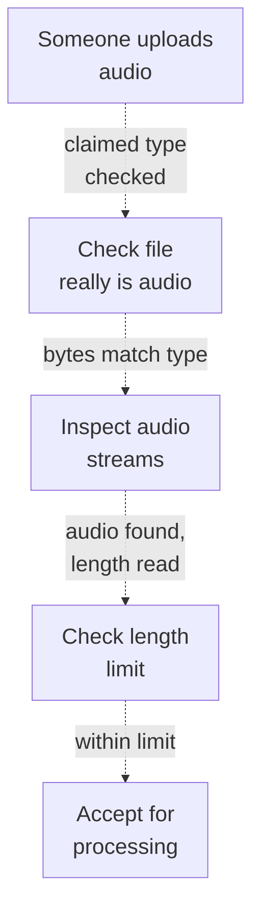

PNG fallback

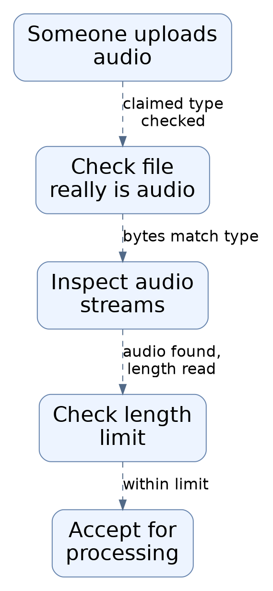

Read from top to bottom. Dashed arrows show connections that need confirmation.

### Source evidence

- **F0008**: inspect_audio validates an uploaded recording by normalizing the claimed MIME type (stripping parameters, lowercasing), checking it against MIME_SIGNATURES, and verifying the file's magic-byte signature (detect_signature) matches; a mismatch raises ApiError 415 UNSUPPORTED_MEDIA. (<a href="https://github.com/Justin-Mendoza/AI-Notetaker/blob/3f279169c3843b77bf5932f79bb601f7bff74120/apps/api/app/services/media.py#L1-L117">apps/api/app/services/media.py:1-117</a>)
- **F0009**: detect_signature reads the first 16 bytes of the file and recognizes webm (EBML 1a45dfa3), ogg (OggS), mp4 (ftyp at offset 4), wav (RIFF....WAVE), and mp3 (ID3 or MPEG frame sync bits), returning None otherwise. (<a href="https://github.com/Justin-Mendoza/AI-Notetaker/blob/3f279169c3843b77bf5932f79bb601f7bff74120/apps/api/app/services/media.py#L1-L117">apps/api/app/services/media.py:1-117</a>)
- **F0010**: inspect_audio shells out to ffprobe to inspect streams and duration: it rejects files with no audio stream or any video stream, and if format duration is missing or 'N/A' it falls back to _packet_duration, which derives duration by running ffprobe for per-packet pts_time/duration_time and taking the last pts+duration. (<a href="https://github.com/Justin-Mendoza/AI-Notetaker/blob/3f279169c3843b77bf5932f79bb601f7bff74120/apps/api/app/services/media.py#L1-L117">apps/api/app/services/media.py:1-117</a>)
- **F0011**: Media inspection failures (OSError, ValueError, JSONDecodeError, subprocess.TimeoutExpired, non-zero ffprobe exit) are converted into ApiError 415 INVALID_MEDIA; ffprobe is invoked with 30s/60s timeouts and check=False, running as an external system. (<a href="https://github.com/Justin-Mendoza/AI-Notetaker/blob/3f279169c3843b77bf5932f79bb601f7bff74120/apps/api/app/services/media.py#L1-L117">apps/api/app/services/media.py:1-117</a>)
- **F0012**: Duration is converted to milliseconds via math.ceil and enforced against MAX_DURATION_MS (120 minutes) plus ENCODER_PADDING_MS (250ms) tolerance; over-limit recordings raise ApiError 413 DURATION_LIMIT, and inspect_audio returns the normalized MIME type and the capped duration in ms. (<a href="https://github.com/Justin-Mendoza/AI-Notetaker/blob/3f279169c3843b77bf5932f79bb601f7bff74120/apps/api/app/services/media.py#L1-L117">apps/api/app/services/media.py:1-117</a>)

## Keeping audio local with the Cohere option

When configured for the local Cohere option, a separate helper process runs on the same machine, bound to 127.0.0.1, and transcribes audio that is temporarily written to a private temp folder and deleted afterwards.

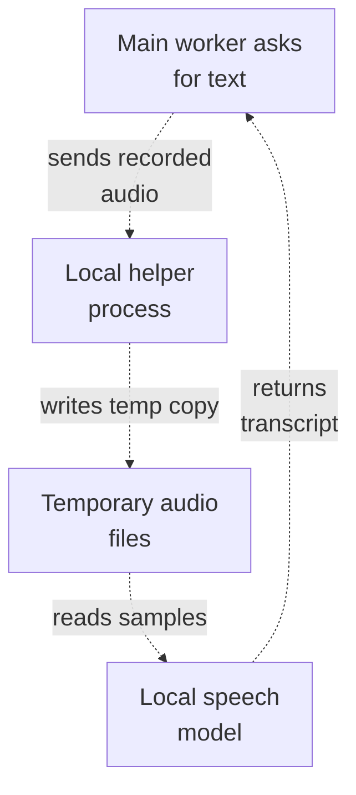

PNG fallback

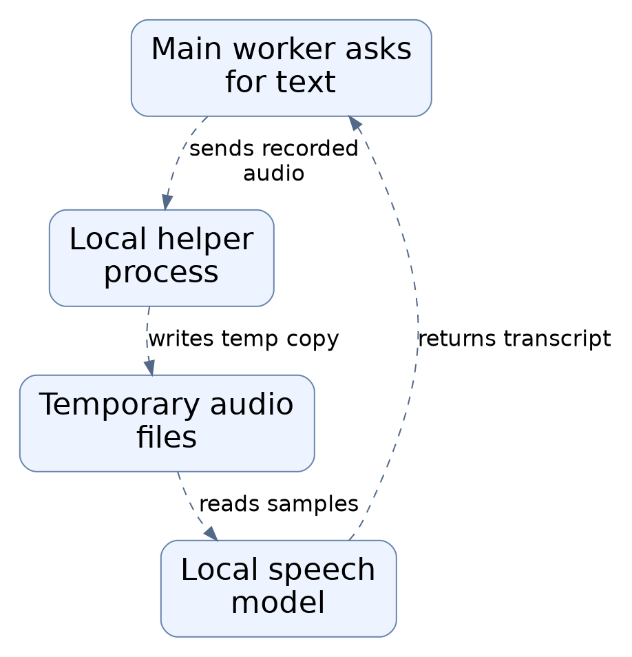

Read from top to bottom. Dashed arrows show connections that need confirmation.

### Source evidence

- **F0076** (inferred): The transcription server exposes no UI; it is a localhost HTTP API meant to be called by the application's transcription client, evidenced by the 401 message 'Use the local transcription client'. (<a href="https://github.com/Justin-Mendoza/AI-Notetaker/blob/3f279169c3843b77bf5932f79bb601f7bff74120/scripts/cohere_server.py#L1-L152">scripts/cohere_server.py:1-152</a>)
- **F0020**: WhisperLocalTranscriber and CohereLocalTranscriber both restrict their base URL to loopback-only HTTP at path /v1 with no credentials, query, or fragment; otherwise they raise TranscriptionError('LOCAL_STT_URL_INVALID', non-transient). They send the file's local path contents to a local service (timeout 3600s, no retries) rather than to a remote cloud, a privacy boundary that keeps audio on the machine. (<a href="https://github.com/Justin-Mendoza/AI-Notetaker/blob/3f279169c3843b77bf5932f79bb601f7bff74120/apps/api/app/services/transcription.py#L1-L126">apps/api/app/services/transcription.py:1-126</a>)
- **F0061**: The Cohere transcription service is a FastAPI app that runs on loopback only and is started as a separate Python process via uvicorn on 127.0.0.1:7778, loaded with app-dir scripts so cohere_server.py is the server module. (<a href="https://github.com/Justin-Mendoza/AI-Notetaker/blob/3f279169c3843b77bf5932f79bb601f7bff74120/scripts/start-cohere-local.sh#L1-L12">scripts/start-cohere-local.sh:1-12</a>)
- **F0063**: On startup the app constructs a CohereWorker, which makes a single-threaded ThreadPoolExecutor (thread prefix cohere-gpu) and builds the CohereEngine on that worker thread; if engine construction fails, the pool is shut down and the error propagates so server startup fails. (<a href="https://github.com/Justin-Mendoza/AI-Notetaker/blob/3f279169c3843b77bf5932f79bb601f7bff74120/scripts/cohere_server.py#L1-L152">scripts/cohere_server.py:1-152</a>)
- **F0064**: CohereEngine loads a local MLX Cohere ASR model from the repo-relative path .data/cohere-model/mlx-int8 and a Silero MLX VAD backend, and forces both to load at init so startup fails when offline assets are missing. (<a href="https://github.com/Justin-Mendoza/AI-Notetaker/blob/3f279169c3843b77bf5932f79bb601f7bff74120/scripts/cohere_server.py#L1-L152">scripts/cohere_server.py:1-152</a>)
- **F0065**: The model identifier defaults to mlx-community/cohere-transcribe-03-2026-mlx-8bit, is overridable via COHERE_LOCAL_MODEL, and is reported by the /health endpoint along with a fixed runtime label 'mlx-speech'. (<a href="https://github.com/Justin-Mendoza/AI-Notetaker/blob/3f279169c3843b77bf5932f79bb601f7bff74120/scripts/cohere_server.py#L1-L152">scripts/cohere_server.py:1-152</a>)
- **F0070**: Uploaded audio is streamed in 1 MiB chunks to a private temp directory under a TemporaryDirectory(prefix='cohere-audio-'); larger than 20,000,000 bytes returns HTTP 413 and an empty upload returns HTTP 400. (<a href="https://github.com/Justin-Mendoza/AI-Notetaker/blob/3f279169c3843b77bf5932f79bb601f7bff74120/scripts/cohere_server.py#L1-L152">scripts/cohere_server.py:1-152</a>)
- **F0074**: Temporary audio is stored only within a temp directory that is deleted when the request completes; the served model files and HF cache live under the repository's .data directory rather than in the app database. (<a href="https://github.com/Justin-Mendoza/AI-Notetaker/blob/3f279169c3843b77bf5932f79bb601f7bff74120/scripts/cohere_server.py#L1-L152">scripts/cohere_server.py:1-152</a>, <a href="https://github.com/Justin-Mendoza/AI-Notetaker/blob/3f279169c3843b77bf5932f79bb601f7bff74120/scripts/start-cohere-local.sh#L1-L12">scripts/start-cohere-local.sh:1-12</a>)
- **F0069**: The POST /v1/audio/transcriptions endpoint requires a Bearer token exactly equal to 'local-cohere'; other values return HTTP 401, and a supplied model form field must equal MODEL or the request returns HTTP 400. (<a href="https://github.com/Justin-Mendoza/AI-Notetaker/blob/3f279169c3843b77bf5932f79bb601f7bff74120/scripts/cohere_server.py#L1-L152">scripts/cohere_server.py:1-152</a>)
- **F0067**: CohereEngine.transcribe reads a WAV with Python wave, converts 16-bit PCM samples to normalized float32, explicitly segments audio with segment_audio (merge_gap_s=1.0, max_chunk_s=35.0) rather than relying on the runtime's built-in vad=True, transcribes each run at sample_rate=16000 with the configured LANGUAGE, and joins non-empty stripped results with spaces. (<a href="https://github.com/Justin-Mendoza/AI-Notetaker/blob/3f279169c3843b77bf5932f79bb601f7bff74120/scripts/cohere_server.py#L1-L152">scripts/cohere_server.py:1-152</a>)
- **F0073**: On success the endpoint returns JSON {"text": &lt;stripped transcription&gt;}; on shutdown the lifespan context closes the worker pool and clears app.state.engine. (<a href="https://github.com/Justin-Mendoza/AI-Notetaker/blob/3f279169c3843b77bf5932f79bb601f7bff74120/scripts/cohere_server.py#L1-L152">scripts/cohere_server.py:1-152</a>)

## Uncertainties and untraced areas

- Where uploaded audio and generated notes are actually stored, and how the web layer hands jobs to the worker, are outside this area's evidence.
- The exact rules for requeueing summaries left unfinished by an earlier worker run are not shown, though the startup call exists.
- The 100 MB file-size constant in media inspection is declared but no size check using it was observed, so enforcement is unconfirmed.
- Whether the summarizer's optional mid-run validity check is wired for every provider is inferred; only the OpenAI path is shown.
- Which concrete provider implements transcription and summarization at runtime depends on configuration; only the selection logic is visible.
- No scheduler invoking the hourly maintenance job is shown; only the worker's own interval loop is evidenced.
- The local Cohere helper is meant to be called by the application's transcription client, but that client code is not in this area's evidence.
