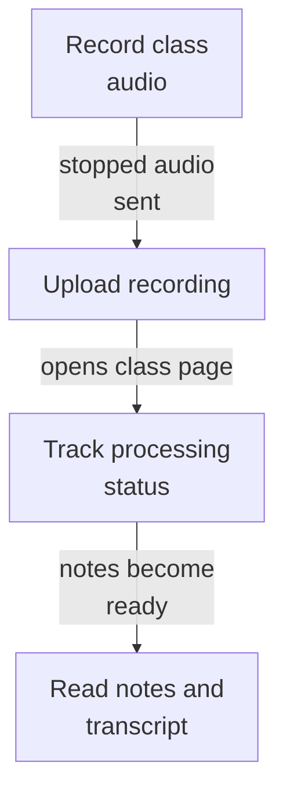
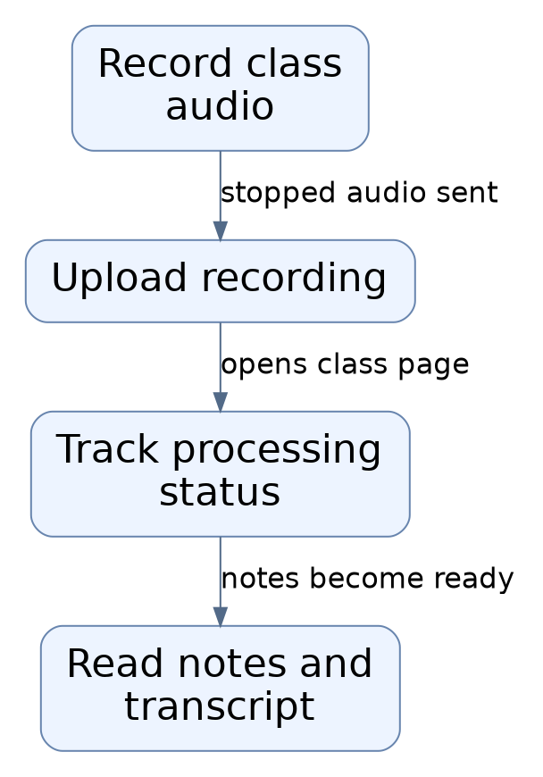
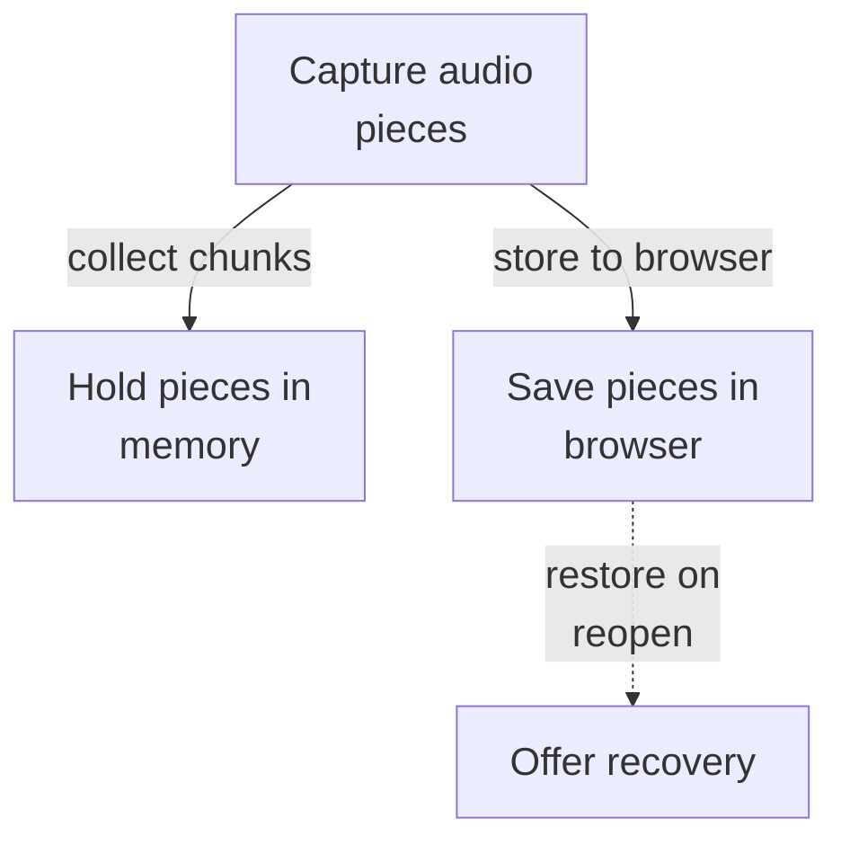
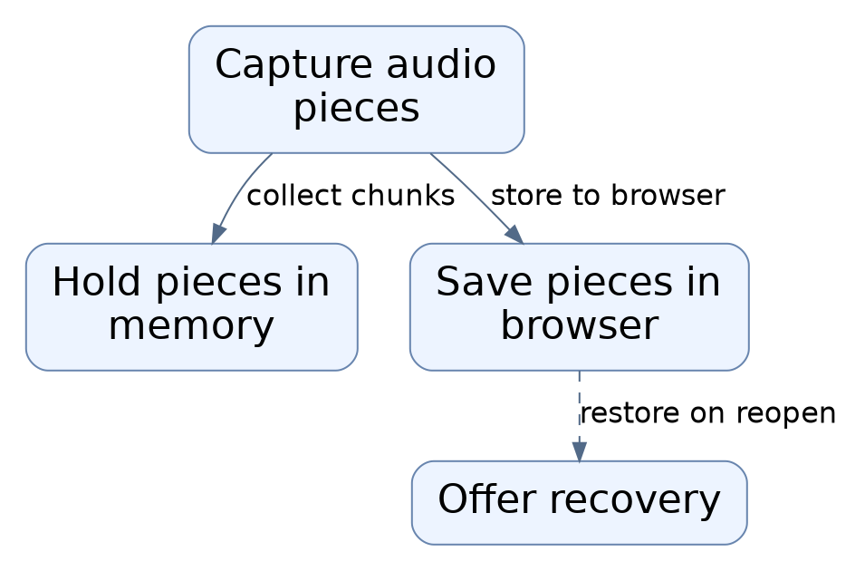
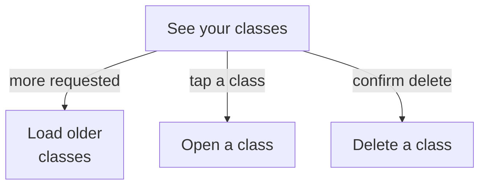
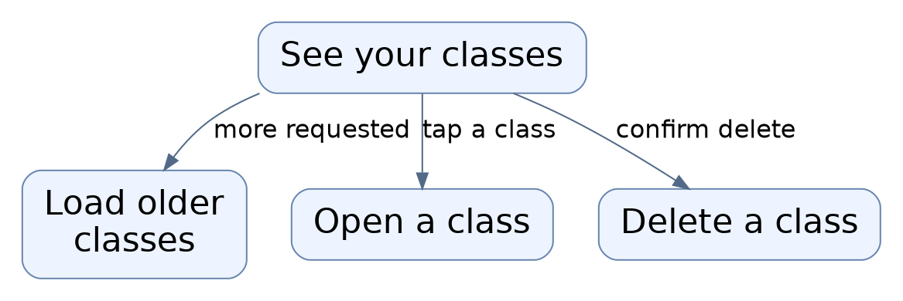
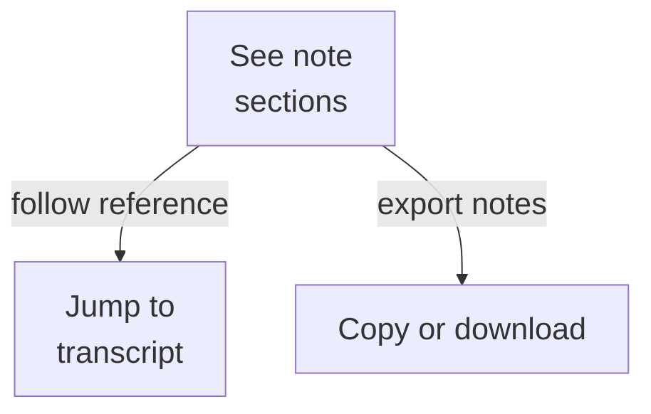
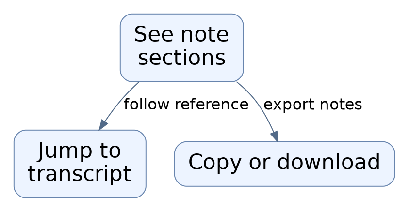
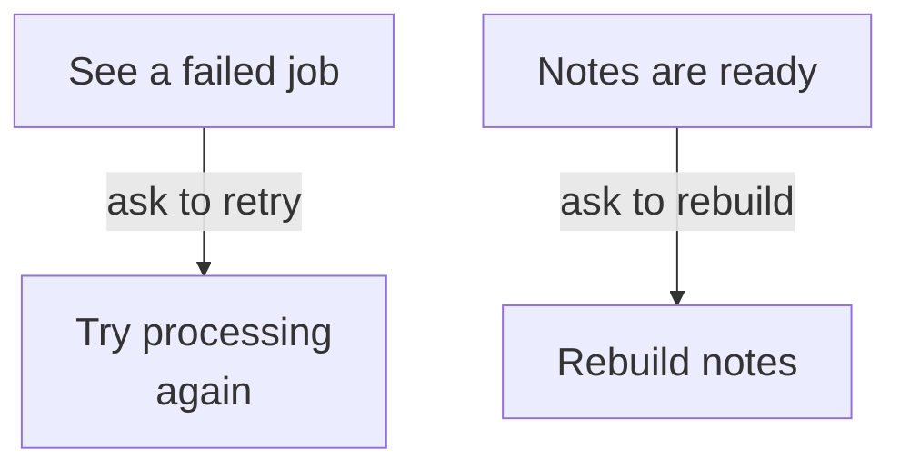
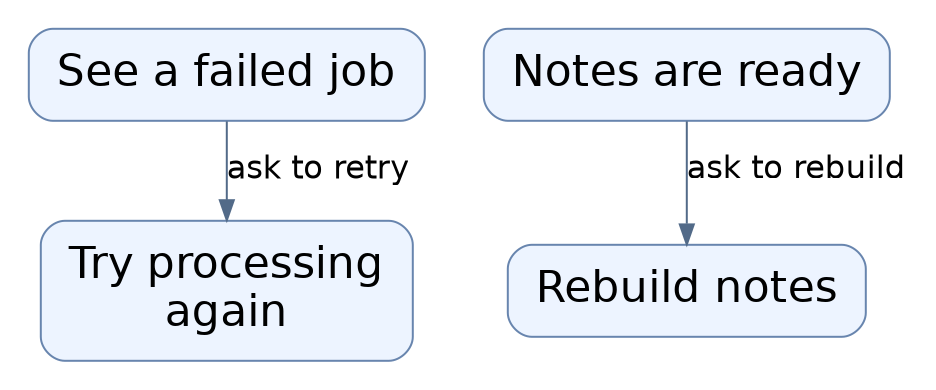

# Repository map

This area is the web workspace for a private class-recording notes tool. From the browser you record a class, watch it upload and be transcribed, then read AI-generated study notes tied back to the transcript. It also lets you browse, rename, regenerate notes for, delete, or recover your recordings.

Commit: `3f279169c3843b77bf5932f79bb601f7bff74120` | Generated: 2026-10-19T00:34:02.537558+00:00

[Open PDF](repository-map.pdf)

**AI-generated analysis. Source references are checked for existence and supplied scope; this does not prove semantic correctness.**

## Scope

Tracked, eligible text only; bounded excerpts, not exhaustive.

12/12 eligible files analyzed; 90 tracked files excluded by policy.

6 API calls. See coverage.json for budgets, exclusions, and usage.

## How a class recording becomes study notes

You record audio in the browser; it is uploaded for processing; afterwards the page shows a transcript and AI-generated notes, refreshed automatically until ready.

PNG fallback

Read from top to bottom; arrows show what happens next or what is passed along.

### Source evidence

- **F0017**: NewMeeting is a client-side page component that drives the entire class-recording workflow from the browser: it captures microphone audio, creates a meeting, streams partial audio for live transcription, and uploads the full recording, then routes to the meeting detail page. It is started by the user opening the /meetings/new route and pressing record after confirming consent. (<a href="https://github.com/Justin-Mendoza/AI-Notetaker/blob/3f279169c3843b77bf5932f79bb601f7bff74120/apps/web/app/meetings/new/page.tsx#L1-L377">apps/web/app/meetings/new/page.tsx:1-377</a>)
- **F0019**: startRecording() first checks browser capability (navigator.mediaDevices.getUserMedia and MediaRecorder), picks the first supported MIME format from formats (webm/opus, mp4, ogg), requests microphone access, and creates the meeting server-side with a POST to `${apiUrl}/v1/meetings` carrying title and consent_confirmed. (<a href="https://github.com/Justin-Mendoza/AI-Notetaker/blob/3f279169c3843b77bf5932f79bb601f7bff74120/apps/web/app/meetings/new/page.tsx#L1-L377">apps/web/app/meetings/new/page.tsx:1-377</a>)
- **F0021**: MediaRecorder is started with a 1-second timeslice; each ondataavailable chunk is appended to chunksRef in memory and, if disk backup is active, persisted asynchronously through appendRecordingBackup with updated metadata (mime and elapsed duration). (<a href="https://github.com/Justin-Mendoza/AI-Notetaker/blob/3f279169c3843b77bf5932f79bb601f7bff74120/apps/web/app/meetings/new/page.tsx#L1-L377">apps/web/app/meetings/new/page.tsx:1-377</a>)
- **F0022**: recorder.onstop rebuilds a Blob from all chunks, computes the duration, waits for pending backup writes, then calls uploadRecording(captured) unless the blob is empty or recording was interrupted (interruptedRef). (<a href="https://github.com/Justin-Mendoza/AI-Notetaker/blob/3f279169c3843b77bf5932f79bb601f7bff74120/apps/web/app/meetings/new/page.tsx#L1-L377">apps/web/app/meetings/new/page.tsx:1-377</a>)
- **F0023**: uploadRecording posts the final audio as multipart FormData to `${apiUrl}/v1/meetings/{meetingId}/recording` via XMLHttpRequest with fields file, duration_ms, and live_transcription=true plus the Idempotency-Key header; a 202 response clears the local backup, resets the blob, sets phase 'queued', and router.push to /meetings/{meetingId}. (<a href="https://github.com/Justin-Mendoza/AI-Notetaker/blob/3f279169c3843b77bf5932f79bb601f7bff74120/apps/web/app/meetings/new/page.tsx#L1-L377">apps/web/app/meetings/new/page.tsx:1-377</a>)
- **F0004**: On mount the detail page fetches GET `${apiUrl}/v1/meetings/${id}` with cache "no-store"; a 404 maps to "Class recording not found." and other failures to a generic load error message shown to the user. If the detail reports has_transcript or has_summary, it then fetches `/v1/meetings/${id}/transcript` and `/v1/meetings/${id}/summary` respectively. (<a href="https://github.com/Justin-Mendoza/AI-Notetaker/blob/3f279169c3843b77bf5932f79bb601f7bff74120/apps/web/app/meetings/%5Bid%5D/page.tsx#L1-L245">apps/web/app/meetings/[id]/page.tsx:1-245</a>)
- **F0005**: While the meeting status is one of uploading/queued/transcribing/summarizing, the page polls the detail endpoint every 4000 ms via setInterval and stops when the status changes, giving live progress feedback without manual refresh. (<a href="https://github.com/Justin-Mendoza/AI-Notetaker/blob/3f279169c3843b77bf5932f79bb601f7bff74120/apps/web/app/meetings/%5Bid%5D/page.tsx#L1-L245">apps/web/app/meetings/[id]/page.tsx:1-245</a>)
- **F0014**: The page displays recording upload size in MB when detail.recording exists and shows meeting date/duration; a status banner (role=status, aria-live=polite) maps backend statuses (queued, draft, uploading, failed, summarizing, ready) to human-readable explanations, and warns users to keep the recording tab open while uploading. (<a href="https://github.com/Justin-Mendoza/AI-Notetaker/blob/3f279169c3843b77bf5932f79bb601f7bff74120/apps/web/app/meetings/%5Bid%5D/page.tsx#L1-L245">apps/web/app/meetings/[id]/page.tsx:1-245</a>)
- **F0010**: The page renders AI-generated class notes only when a summary is loaded, including overview, numbered topics with "What was explained" and key details, quick review points, decisions, an action-items table (task/owner/due date), and open questions; sections show explicit empty-state text when lists are empty. (<a href="https://github.com/Justin-Mendoza/AI-Notetaker/blob/3f279169c3843b77bf5932f79bb601f7bff74120/apps/web/app/meetings/%5Bid%5D/page.tsx#L1-L245">apps/web/app/meetings/[id]/page.tsx:1-245</a>)
- **F0012**: The transcript section shows a copy-to-clipboard button and a download .txt button; individual segments render minute ranges (~start–end min) and use "[No speech detected in this chunk]" placeholder text when a segment has no text. (<a href="https://github.com/Justin-Mendoza/AI-Notetaker/blob/3f279169c3843b77bf5932f79bb601f7bff74120/apps/web/app/meetings/%5Bid%5D/page.tsx#L1-L245">apps/web/app/meetings/[id]/page.tsx:1-245</a>)

## Recording hundreds of small pieces safely

Audio is captured in one-second pieces. Pieces are kept in memory and also saved in the browser, so a crash or closed tab does not lose an unfinished recording.

PNG fallback

Read from top to bottom. Dashed arrows show connections that need confirmation.

### Source evidence

- **F0021**: MediaRecorder is started with a 1-second timeslice; each ondataavailable chunk is appended to chunksRef in memory and, if disk backup is active, persisted asynchronously through appendRecordingBackup with updated metadata (mime and elapsed duration). (<a href="https://github.com/Justin-Mendoza/AI-Notetaker/blob/3f279169c3843b77bf5932f79bb601f7bff74120/apps/web/app/meetings/new/page.tsx#L1-L377">apps/web/app/meetings/new/page.tsx:1-377</a>)
- **F0022**: recorder.onstop rebuilds a Blob from all chunks, computes the duration, waits for pending backup writes, then calls uploadRecording(captured) unless the blob is empty or recording was interrupted (interruptedRef). (<a href="https://github.com/Justin-Mendoza/AI-Notetaker/blob/3f279169c3843b77bf5932f79bb601f7bff74120/apps/web/app/meetings/new/page.tsx#L1-L377">apps/web/app/meetings/new/page.tsx:1-377</a>)
- **F0057**: recording-backup.ts persists a single unfinished recording to the browser's IndexedDB database 'class-notes-recording', storing recording metadata under key 'active' in a 'metadata' object store and ordered audio chunks in an auto-incrementing 'chunks' object store. (<a href="https://github.com/Justin-Mendoza/AI-Notetaker/blob/3f279169c3843b77bf5932f79bb601f7bff74120/apps/web/lib/recording-backup.ts#L1-L92">apps/web/lib/recording-backup.ts:1-92</a>)
- **F0059**: appendRecordingBackup adds an audio Blob chunk to the chunks store only if the stored 'active' metadata's meetingId and uploadKey match the supplied metadata, otherwise it aborts the transaction, preventing chunks from a different recording from being mixed in. (<a href="https://github.com/Justin-Mendoza/AI-Notetaker/blob/3f279169c3843b77bf5932f79bb601f7bff74120/apps/web/lib/recording-backup.ts#L1-L92">apps/web/lib/recording-backup.ts:1-92</a>)
- **F0018**: On mount the page acquires an exclusive recorder session via acquireRecorderSession() and reads any prior unfinished-recording backup via readRecordingBackup(); if another tab holds the session it shows a busy message, and if a backup exists it restores the saved meetingId, uploadKey, duration, title, and audio blob into an error/recovery state instead of starting fresh. (<a href="https://github.com/Justin-Mendoza/AI-Notetaker/blob/3f279169c3843b77bf5932f79bb601f7bff74120/apps/web/app/meetings/new/page.tsx#L1-L377">apps/web/app/meetings/new/page.tsx:1-377</a>)
- **F0032**: Recovery behavior is limited: after a recovered backup the page states recording did not continue while the page was closed, so recovery only offers download or retry upload of the already-captured audio. (<a href="https://github.com/Justin-Mendoza/AI-Notetaker/blob/3f279169c3843b77bf5932f79bb601f7bff74120/apps/web/app/meetings/new/page.tsx#L1-L377">apps/web/app/meetings/new/page.tsx:1-377</a>)
- **F0062**: readRecordingBackup reads the active metadata and all chunks in one readonly transaction and returns a reconstructed audio Blob typed with the saved mime, or null when there is no metadata or no chunks. (<a href="https://github.com/Justin-Mendoza/AI-Notetaker/blob/3f279169c3843b77bf5932f79bb601f7bff74120/apps/web/lib/recording-backup.ts#L1-L92">apps/web/lib/recording-backup.ts:1-92</a>)

## Managing your saved classes

The home page lists your classes with dates, lengths, and status. You can open one, delete it, or load older classes.

PNG fallback

Read from top to bottom; arrows show what happens next or what is passed along.

### Source evidence

- **F0033**: The web home page (Home component in app/page.tsx) is a client-side React page that loads and displays a paginated list of the user's saved class meetings, and serves as the entry point to recording and reviewing classes. (<a href="https://github.com/Justin-Mendoza/AI-Notetaker/blob/3f279169c3843b77bf5932f79bb601f7bff74120/apps/web/app/page.tsx#L1-L79">apps/web/app/page.tsx:1-79</a>)
- **F0034**: loadMeetings fetches GET /v1/meetings from a configured API base URL (apiUrl), optionally appending a cursor query parameter for pagination, with cache disabled; on success it stores items into component state and sets next_cursor, on any failure it sets a user-facing error message. (<a href="https://github.com/Justin-Mendoza/AI-Notetaker/blob/3f279169c3843b77bf5932f79bb601f7bff74120/apps/web/app/page.tsx#L1-L79">apps/web/app/page.tsx:1-79</a>)
- **F0035**: A timer-driven useEffect runs loadMeetings on mount, and a Refresh button re-invokes loadMeetings; when a nextCursor is returned the UI exposes a 'Load more classes' button that calls loadMeetings(nextCursor) to append further pages. (<a href="https://github.com/Justin-Mendoza/AI-Notetaker/blob/3f279169c3843b77bf5932f79bb601f7bff74120/apps/web/app/page.tsx#L1-L79">apps/web/app/page.tsx:1-79</a>)
- **F0053**: Meeting listing supports cursor-based pagination via limit and cursor query parameters, returning items and a nullable next_cursor. (<a href="https://github.com/Justin-Mendoza/AI-Notetaker/blob/3f279169c3843b77bf5932f79bb601f7bff74120/apps/web/lib/api-types.ts#L1-L634">apps/web/lib/api-types.ts:1-634</a>)
- **F0037**: Each meeting row displays a title, a formatted creation date, either 'No audio yet' or a rounded-up minutes duration derived from duration_ms, and a status pill mapped through statusLabels covering ready, draft, queued, uploading, transcribing, summarizing, and failed states. (<a href="https://github.com/Justin-Mendoza/AI-Notetaker/blob/3f279169c3843b77bf5932f79bb601f7bff74120/apps/web/app/page.tsx#L1-L79">apps/web/app/page.tsx:1-79</a>)
- **F0040**: Navigation into per-class detail and recording flows is done via Next.js Link to routes /meetings/[id] and /meetings/new, so the actual recording, transcription, and note-generation behavior lives in those other pages (not shown here). (<a href="https://github.com/Justin-Mendoza/AI-Notetaker/blob/3f279169c3843b77bf5932f79bb601f7bff74120/apps/web/app/page.tsx#L1-L79">apps/web/app/page.tsx:1-79</a>)
- **F0036**: deleteMeeting prompts the user with window.confirm, then sends DELETE /v1/meetings/{id}; on success it calls clearRecordingBackup(id), removes the meeting from local state, and shows a confirmation message about private audio cleanup being queued; on failure it shows a deletion error message. (<a href="https://github.com/Justin-Mendoza/AI-Notetaker/blob/3f279169c3843b77bf5932f79bb601f7bff74120/apps/web/app/page.tsx#L1-L79">apps/web/app/page.tsx:1-79</a>)
- **F0042** (inferred): clearRecordingBackup is imported from lib/recording-backup and invoked with a meeting id after deletion, indicating local audio backup data is cleaned up separately from the server-side delete, but its internals are not shown in these excerpts. (<a href="https://github.com/Justin-Mendoza/AI-Notetaker/blob/3f279169c3843b77bf5932f79bb601f7bff74120/apps/web/app/page.tsx#L1-L79">apps/web/app/page.tsx:1-79</a>)

## Reading and taking notes with you

The note view shows overview, topics, decisions, and action items, with links back to transcript moments. You can copy transcript text, download it, or export notes as a document.

PNG fallback

Read from top to bottom; arrows show what happens next or what is passed along.

### Source evidence

- **F0010**: The page renders AI-generated class notes only when a summary is loaded, including overview, numbered topics with "What was explained" and key details, quick review points, decisions, an action-items table (task/owner/due date), and open questions; sections show explicit empty-state text when lists are empty. (<a href="https://github.com/Justin-Mendoza/AI-Notetaker/blob/3f279169c3843b77bf5932f79bb601f7bff74120/apps/web/app/meetings/%5Bid%5D/page.tsx#L1-L245">apps/web/app/meetings/[id]/page.tsx:1-245</a>)
- **F0011**: Topics/decisions/action items carry evidence_segment_ids; the page resolves them against transcript segments and renders in-page anchor links showing approximate minute offsets (~N min) that jump to `#segment-&lt;id&gt;` transcript entries. (<a href="https://github.com/Justin-Mendoza/AI-Notetaker/blob/3f279169c3843b77bf5932f79bb601f7bff74120/apps/web/app/meetings/%5Bid%5D/page.tsx#L1-L245">apps/web/app/meetings/[id]/page.tsx:1-245</a>)
- **F0012**: The transcript section shows a copy-to-clipboard button and a download .txt button; individual segments render minute ranges (~start–end min) and use "[No speech detected in this chunk]" placeholder text when a segment has no text. (<a href="https://github.com/Justin-Mendoza/AI-Notetaker/blob/3f279169c3843b77bf5932f79bb601f7bff74120/apps/web/app/meetings/%5Bid%5D/page.tsx#L1-L245">apps/web/app/meetings/[id]/page.tsx:1-245</a>)
- **F0013**: Copy notes and Download .md build a Markdown document (notesMarkdown) locally from the loaded summary and meeting metadata — including an "AI draft — review before using or sharing" banner — and use browser Blob/URL.createObjectURL and an anchor click; object URLs are revoked after 60s. Note titles are sanitized for filenames. (<a href="https://github.com/Justin-Mendoza/AI-Notetaker/blob/3f279169c3843b77bf5932f79bb601f7bff74120/apps/web/app/meetings/%5Bid%5D/page.tsx#L1-L245">apps/web/app/meetings/[id]/page.tsx:1-245</a>)

## Reworking or retrying a class

When processing fails you can ask for it to be tried again; when notes exist you can ask for them to be rebuilt from the saved transcript while the old draft stays visible.

PNG fallback

Read from top to bottom; arrows show what happens next or what is passed along.

### Source evidence

- **F0007**: When a job is in status "failed", the page shows last_error_code and offers a "Retry processing" action that POSTs `${apiUrl}/v1/meetings/${id}/retry`; non-OK responses surface payload.error.message, and success shows "Processing queued again" then reloads. (<a href="https://github.com/Justin-Mendoza/AI-Notetaker/blob/3f279169c3843b77bf5932f79bb601f7bff74120/apps/web/app/meetings/%5Bid%5D/page.tsx#L1-L245">apps/web/app/meetings/[id]/page.tsx:1-245</a>)
- **F0048**: Background processing is modeled by a job object (JobOut) exposing id, status, stage, attempts, cursor, and last_error_code, exposed via the meeting detail response as a nullable job. (<a href="https://github.com/Justin-Mendoza/AI-Notetaker/blob/3f279169c3843b77bf5932f79bb601f7bff74120/apps/web/lib/api-types.ts#L1-L634">apps/web/lib/api-types.ts:1-634</a>)
- **F0008**: When status is "ready" and a summary exists, a "Regenerate class notes" action POSTs `${apiUrl}/v1/meetings/${id}/regenerate`, telling the user notes are being updated from the saved transcript; errors surface payload.error.message or a connection error. (<a href="https://github.com/Justin-Mendoza/AI-Notetaker/blob/3f279169c3843b77bf5932f79bb601f7bff74120/apps/web/app/meetings/%5Bid%5D/page.tsx#L1-L245">apps/web/app/meetings/[id]/page.tsx:1-245</a>)
- **F0010**: The page renders AI-generated class notes only when a summary is loaded, including overview, numbered topics with "What was explained" and key details, quick review points, decisions, an action-items table (task/owner/due date), and open questions; sections show explicit empty-state text when lists are empty. (<a href="https://github.com/Justin-Mendoza/AI-Notetaker/blob/3f279169c3843b77bf5932f79bb601f7bff74120/apps/web/app/meetings/%5Bid%5D/page.tsx#L1-L245">apps/web/app/meetings/[id]/page.tsx:1-245</a>)
- **F0052**: Separate endpoints regenerate a summary and retry a failed meeting (RetryResponse with status), indicating recovery and re-run capabilities for processing jobs. (<a href="https://github.com/Justin-Mendoza/AI-Notetaker/blob/3f279169c3843b77bf5932f79bb601f7bff74120/apps/web/lib/api-types.ts#L1-L634">apps/web/lib/api-types.ts:1-634</a>)
- **F0016** (inferred): The status banner for failed jobs states that previous notes remain available during regeneration, and the summarizing state distinguishes first-time summarization from an update of existing notes, implying the backend preserves old drafts while a new summary is generated; this behavior is asserted by UI text, not verified backend logic here. (<a href="https://github.com/Justin-Mendoza/AI-Notetaker/blob/3f279169c3843b77bf5932f79bb601f7bff74120/apps/web/app/meetings/%5Bid%5D/page.tsx#L1-L245">apps/web/app/meetings/[id]/page.tsx:1-245</a>)

## Uncertainties and untraced areas

- The page shows that previously saved notes stay usable while new ones are generated, but this is stated in interface text rather than confirmed by backend behavior here.
- It is not shown how recording backups are first written; only reading, appending, and clearing them are covered, so the start of a backup is unconfirmed.
- Recording and transcription behavior in the detail and new-recording pages is described from these files alone; the actual runtime wiring across the whole app cannot be fully confirmed.
- Browsers that lack the required storage and locking features may fail to record or recover; only the missing-locking failure is described explicitly.
