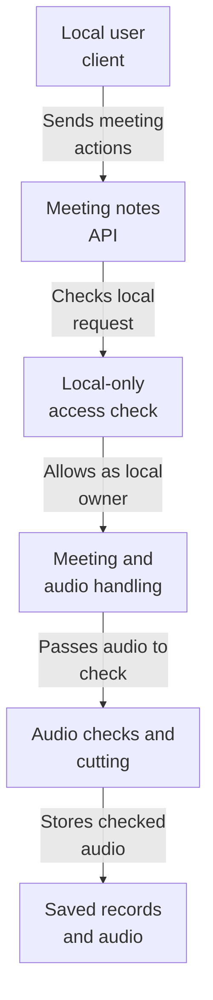
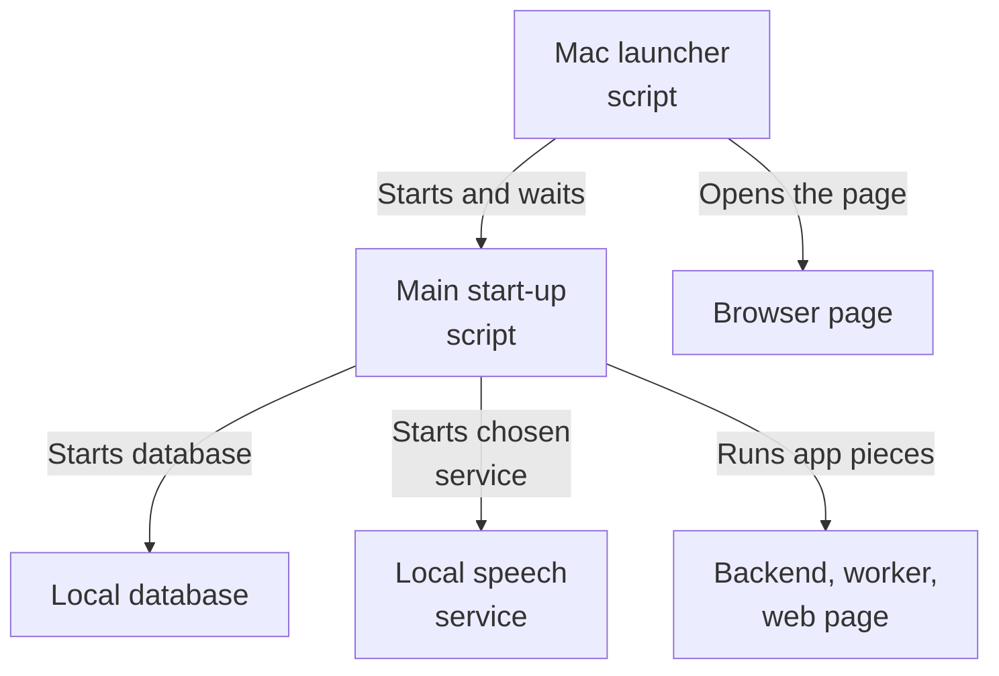
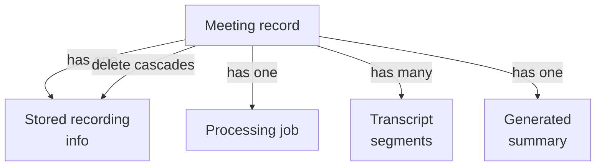
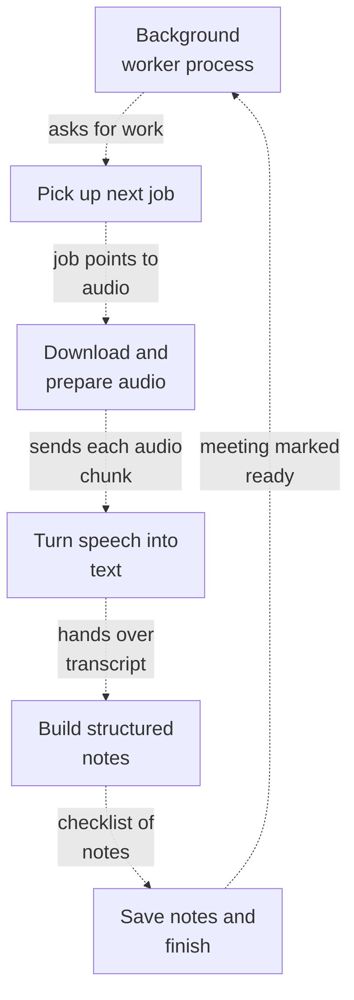
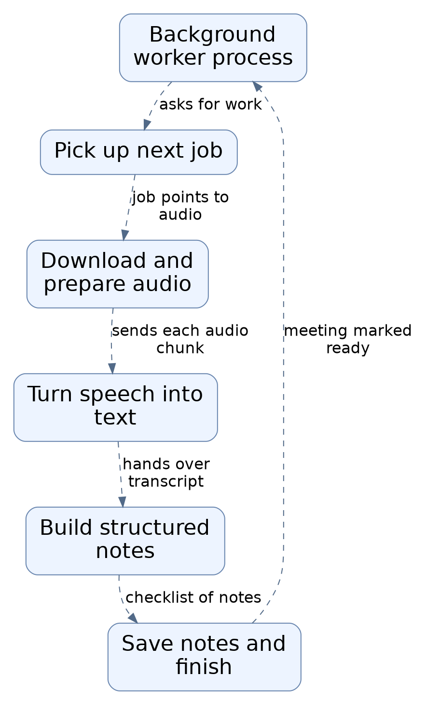
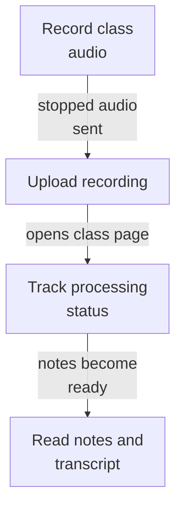

# Repository map

The overview brings together the analyzed architecture view from each subsystem. Open a subsystem map for its source evidence, detailed flows, and uncertainties.

Commit: `3f279169c3843b77bf5932f79bb601f7bff74120` | Generated: 2026-10-19T00:34:02.817194+00:00

[Open PDF](repository-map.pdf)

**AI-generated analysis. Source references are checked for existence and supplied scope; this does not prove semantic correctness.**

## Scope

Source-backed architecture views composed from each subsystem map. See linked subsystem pages for evidence.

0/0 eligible files analyzed; 0 tracked files excluded by policy.

0 API calls. See coverage.json for budgets, exclusions, and usage.

## meeting-api: How a recording becomes study notes (1/2)

A local client asks the API to create a meeting and send audio; the system verifies the request is local, checks and stores the audio, queues a job, transcribes it, and builds structured study notes.

PNG fallback

Read from top to bottom; arrows show what happens next or what is passed along.

### Source evidence

## operations: How the app starts up

A person runs the Mac launcher, which starts the database, picks a local speech service, and brings up the app so the page opens in a browser.

PNG fallback

Read from top to bottom; arrows show what happens next or what is passed along.

### Source evidence

## persistence: How a meeting's notes data is organized

A meeting is the central record. Its recording, processing job, transcript pieces, and summary all belong to it, and removing the meeting removes them all.

PNG fallback

Read from top to bottom; arrows show what happens next or what is passed along.

### Source evidence

## processing: How a recording becomes meeting notes

A background worker process loops continuously, claiming one queued job at a time, transcribing and then summarizing it, and saving the outcome.

PNG fallback

Read from top to bottom. Dashed arrows show connections that need confirmation.

### Source evidence

## web: How a class recording becomes study notes

You record audio in the browser; it is uploaded for processing; afterwards the page shows a transcript and AI-generated notes, refreshed automatically until ready.

PNG fallback

Read from top to bottom; arrows show what happens next or what is passed along.

### Source evidence

## Uncertainties and untraced areas

- Subsystem boundaries and configured or import-inferred dependencies are recorded in manifest.json; they do not establish runtime calls.
